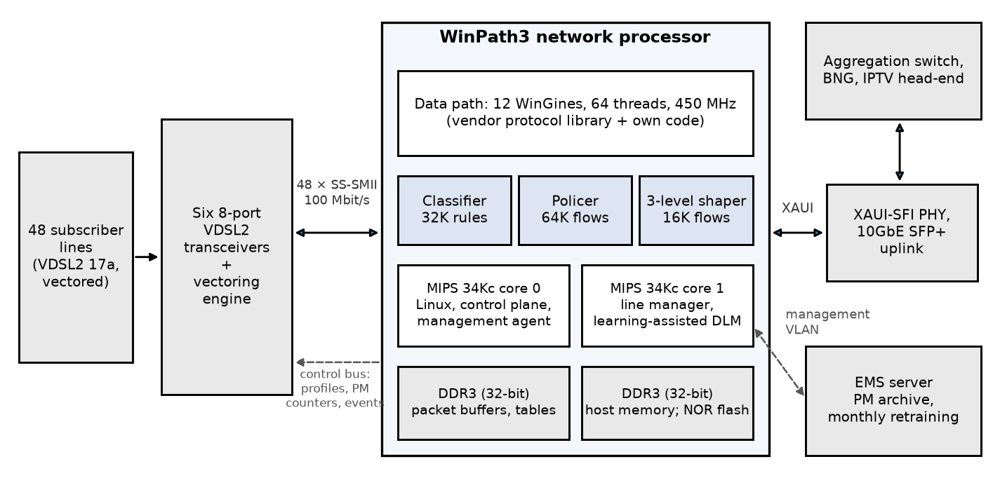
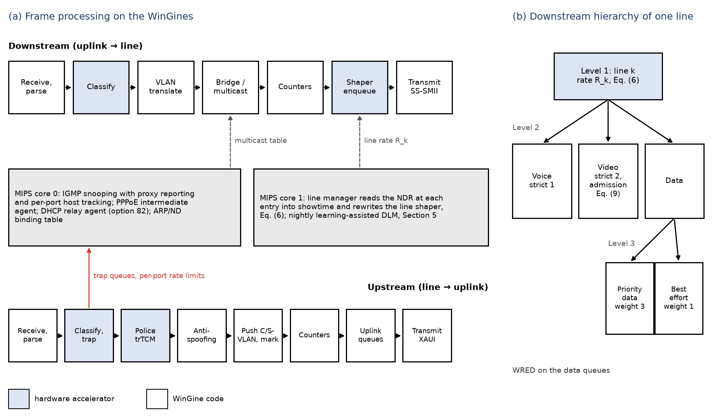
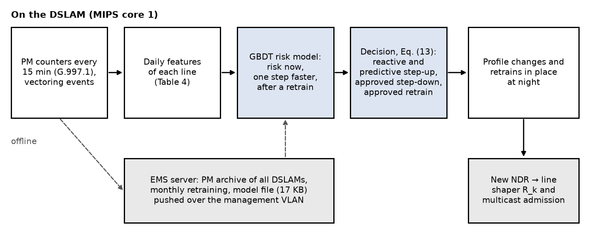
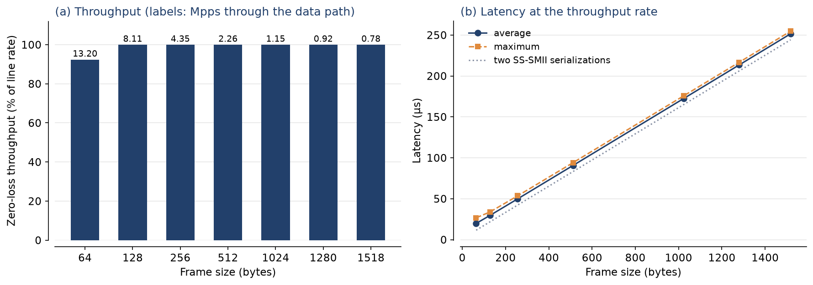
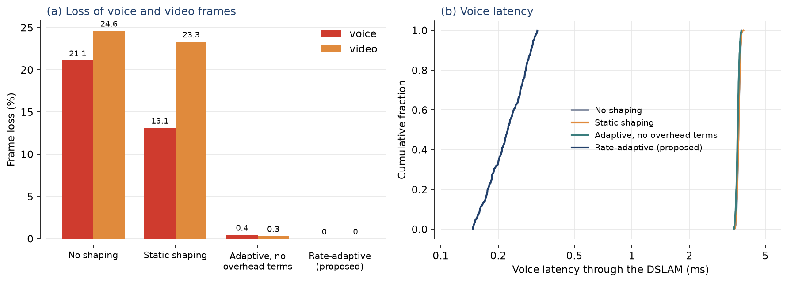
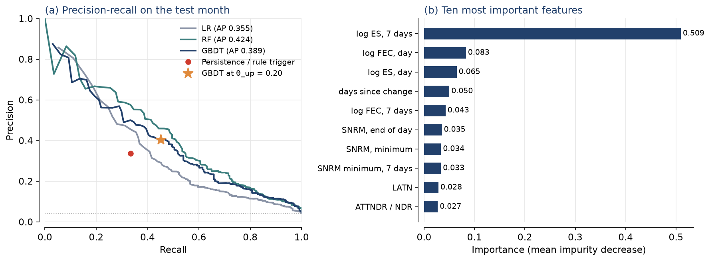
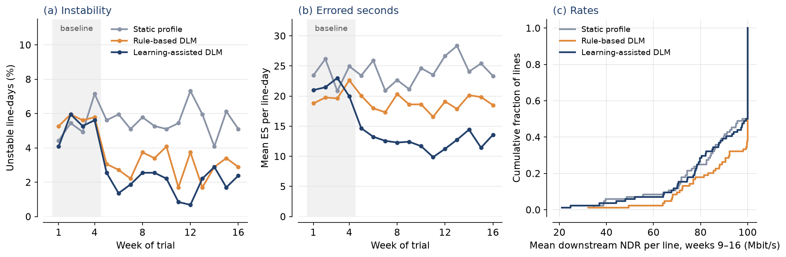
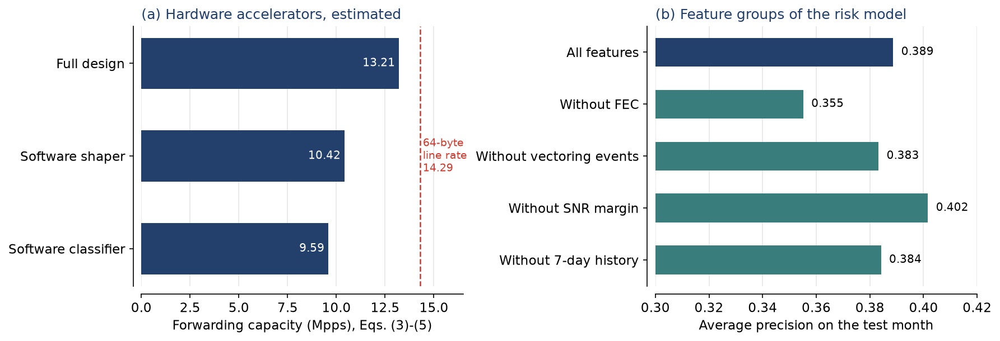
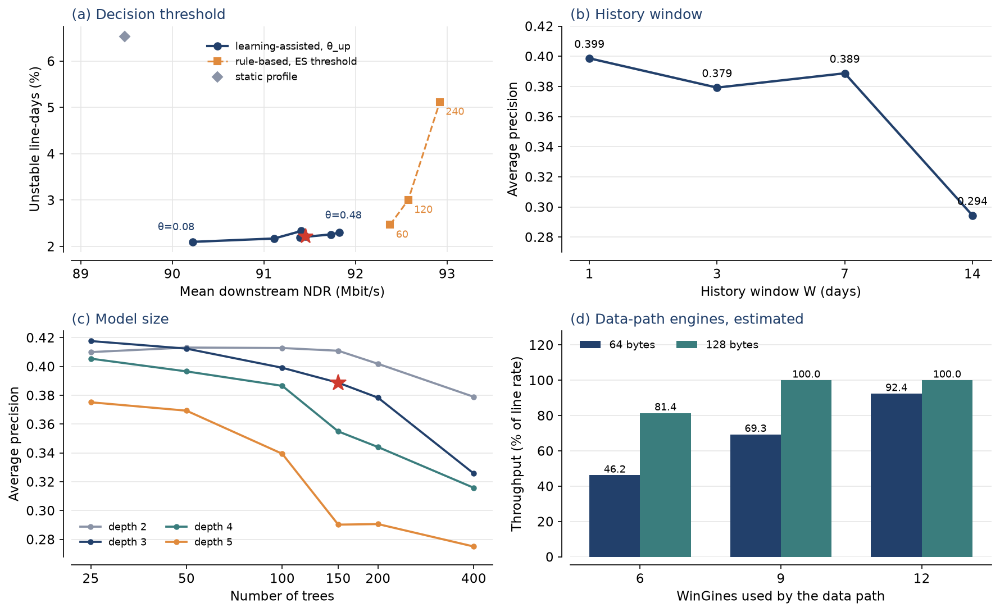

# A Study on the Design and Implementation of a VDSL2 DSLAM Based on the WinPath3 Network Processor with Learning-Assisted Line Management

Haoran Zheng^a^, Yuting Shen^a,\*^, Wenjie Kong^b^, Lei Fan^b^

^a^ School of Information and Communication Engineering, Fenghe University of Technology, Xi'an 710121, China\
^b^ Access Network Products Division, Qinyuan Communication Equipment Co., Ltd., Xi'an 710075, China

\* Corresponding author. E-mail address: shenyuting@fhut.edu.cn (Y. Shen).

**Teaching example: the authors, institutions, dataset and results in this paper are fictional.**

## Abstract

Many residential compounds built in Chinese cities in the 1980s and 1990s still reach each flat only through the telephone pairs of the original building, and where fibre cannot be pulled into the flats an access node in the building that serves these pairs with VDSL2 remains the practical way to deliver a 100 Mbit/s service. Such a node must aggregate the lines onto Ethernet with the service separation, multicast handling and protection required of broadband access nodes, it must keep voice and video intact when a line retrains to a lower rate, and it must keep old and noisy lines stable without constant manual attention. This paper presents the design and implementation of a 48-port VDSL2 digital subscriber line access multiplexer (DSLAM) built around a single WinPath3 network processor. The access-node functions are mapped onto the twelve multi-threaded data-path engines, the hardware classifier, policer and three-level shaper of the device, and its two MIPS cores, and a dimensioning model built from a per-stage cycle budget is used to size the data path. The shaper node of each line follows the net data rate of the line at every retrain, with compensation for the overhead of the packet transfer mode, so that queueing and priority stay in the network processor rather than in the transceivers. On the second control core, a gradient-boosted tree model of 17 KB predicts from the daily performance counters whether a line will be unstable on the next day. It is placed around the operator's rule-based line management, where it brings forward moves to more robust profiles, approves or vetoes moves to faster profiles, and approves retrains that recover rate lost in earlier retrains. On the prototype the data path forwarded 92.4% of the line rate for 64-byte frames and the full line rate from 128 bytes upwards. After a forced retrain from 92 to 71 Mbit/s, rate-adaptive shaping delivered all voice and video frames with a mean voice latency of 0.23 ms, whereas static shaping lost 13.1% of the voice frames. The risk model reached an average precision of 0.389, against 0.141 for the trigger of the rule. In a 16-week field trial on 252 lines, the learning-assisted policy reduced the share of unstable line-days from 5.23% to 1.98%, against 5.65% to 2.96% for the rule-based policy, with 43.0% fewer planned retrains, but its lines lost 2.05 Mbit/s of mean rate against 0.28 Mbit/s. Repeated simulations confirmed this trade-off: compared with the rule, the learning-assisted policy had 0.78 percentage points fewer unstable line-days and half the planned retrains at a mean rate 1.12 Mbit/s lower.

*Keywords:* DSLAM; VDSL2; Network processor; WinPath3; Hierarchical QoS; Dynamic line management; Gradient-boosted decision trees

## 1. Introduction

Fibre to the home now serves most broadband users in Chinese cities, but the last tens of metres to the flat are not always open to fibre. Many residential compounds built in the 1980s and 1990s consist of walk-up buildings of six or seven storeys in which each flat is reached by a telephone pair from a cross-connect box in the stairwell, and the renovation of such compounds in recent years has often improved façades, pipes and lifts while leaving the cabling in place. When residents or building management do not allow new drop cables through walls and stairwells, an access node placed in the building and fed by fibre can serve the existing pairs with VDSL2 [1], whose vectoring extension [2] cancels the crosstalk between the pairs of a cable and makes 100 Mbit/s attainable over the short loops of a building. Hybrid fibre-copper deployments of this kind have been modelled from the network data of more than 21,000 lines [3], and research on copper access continues to push towards higher frequencies and more sophisticated crosstalk cancellation [4], so that the copper of old buildings is likely to carry broadband for some years.

The access node of such a deployment, the digital subscriber line access multiplexer (DSLAM), must do more than convert DSL into Ethernet. The requirements for Ethernet-based aggregation [5] ask it to separate the services of each subscriber into virtual LANs, to insert line identifiers into the PPPoE and DHCP exchanges, to handle IPTV multicast through IGMP, to protect itself and the network against spoofing and floods, and to apply priorities so that voice and video survive congestion. The packet processing that implements these functions can be built in several ways. Programmable hardware can be programmed in high-level languages and reaches very high rates [6], and programmable data planes have opened the forwarding plane of switches to new functions, including those driven by machine learning [7, 8], but these platforms are designed for data centres and core networks rather than for a small box with dozens of subscriber lines. Network processors designed for access equipment, such as the WinPath3 [9], combine interfaces for many subscriber lines, hardware accelerators for classification, policing and hierarchical shaping, two general-purpose cores and a library of production protocol software, which suits a small design team that cannot afford to develop an integrated circuit.

A second difficulty concerns the lines themselves. Old in-building cables share their routes with power wiring, lifts and household appliances. Impulse noise from these sources produces errored seconds and occasional retrains, and interference from power line communication adapters can reduce the rate of a line substantially where the coupling is strong [10]. Dynamic spectrum management [11] and, in its simplest operational form, dynamic line management adjust the configuration of each line from its performance counters [12], typically by moving an unstable line to a profile with more margin or more impulse noise protection and by moving it back after a period of stability. Machine learning has recently been applied to the interpretation of DSL channel measurements [13] and to the classification of faults in copper access networks [14], to fault prediction and early warning in optical networks [15, 16], and to the maintenance of home broadband [17]. These studies run their models on central systems, and some of them use large models. It remains open how much a small model running inside the access node can add to the rule-based line management that operators already use.

This paper addresses both problems in one design. The main contributions are as follows.

(1) A 48-port VDSL2 DSLAM for residential buildings is designed and implemented around a single WinPath3. The access-node functions are mapped onto the data-path engines, the hardware accelerators and the two control cores, and a dimensioning model built from a per-stage cycle budget overestimates the measured forwarding capacity of the data path by only 4.3%.

(2) Rate-adaptive hierarchical scheduling is proposed for the downstream direction. The shaper node of each line follows the net data rate of the line at every entry into showtime and charges each frame its overhead in the packet transfer mode of VDSL2, so that queueing and strict priority stay in the network processor, and the admission of multicast channels is tied to the same rate.

(3) A learning-assisted line manager is developed for the second control core. A gradient-boosted tree model predicts next-day instability from the daily performance counters and is placed around the operator's rule: it brings forward moves to more robust profiles, approves or vetoes moves to faster profiles, and approves retrains in place that recover rate. The manager is evaluated on six months of pilot data, in a 16-week field trial on 252 lines and in repeated simulations, with ablation and sensitivity studies.

The remainder of the paper is organized as follows. Section 2 reviews related work. Section 3 describes the requirements and the architecture of the DSLAM, and Section 4 the design of the data path. Section 5 presents the learning-assisted line management. Section 6 reports the experiments, Section 7 discusses the results and the limitations, and Section 8 concludes the paper.

## 2. Related work

### 2.1 VDSL2 access and line management

VDSL2 [1] transmits discrete multitone signals over twisted pairs and, in profile 17a, uses frequencies up to 17.664 MHz. The 2019 edition consolidates the amendments made since 2011. Its rate on a given loop is limited mainly by far-end crosstalk (FEXT) from the other pairs of the cable, and vectoring [2] removes the self-FEXT among the lines of a vectored group in both directions by precoding downstream and joint cancellation upstream. Research on the next generations of copper access has continued. Zhang et al. [4] surveyed FEXT mitigation for networks beyond G.mgfast, whose spectrum of 424 or 848 MHz produces far stronger FEXT than VDSL2 or G.fast, and argued for lattice-reduction techniques borrowed from wireless communication. Zhang et al. [18] proposed differential evolution aided turbo channel estimation and multi-user detection for the G.fast upstream, which approached the optimal detector at about 5% of its complexity. On the deployment side, Statovci et al. [3] modelled G.fast with the network data of 21,344 lines at 36 locations in Austria, found that it should be deployed from the remote node in urban and suburban areas and from the last distribution point in rural ones, and shared measurements of 695 twisted pairs. These studies concern the physical layer and the planning of copper networks, and they take the access node itself as given.

The performance of a line depends on its noise environment as much as on its length. Galli et al. [10] measured the coupling between power line cables and twisted pairs and showed that interference from broadband power line communication has a small average impact on the rate of VDSL2, vectored VDSL2 and G.fast, but that strong couplings can degrade a line substantially, and that the impact varies with loop length and with the use of vectoring. Song et al. [11] introduced dynamic spectrum management, in which DSL transmission adapts to the channel and to neighbouring systems instead of being designed for the worst case. The management information on which such adaptation relies, including errored and severely errored seconds, corrections by forward error correction, full initializations, signal-to-noise ratio (SNR) margins and attainable rates, is defined by the physical-layer management of DSL [12]. Dynamic line management in operational networks uses these counters, usually through hand-set thresholds.

### 2.2 Packet processing platforms for access equipment

The functions that an access node must provide for Ethernet-based aggregation are set out in TR-101 [5], including the 1:1 and N:1 VLAN models, IGMP processing, the PPPoE intermediate agent, the DHCP relay agent with line identification, and priority handling. How these functions are implemented is a matter of the platform. Li et al. [6] built ClickNP, a platform in which network functions are written in a high-level C-like language and run on FPGAs in commodity servers, and reported up to 200 million packets per second at latencies below 2 µs. Quan et al. [7] surveyed packet forwarding driven by artificial intelligence on programmable data planes in terms of delay, throughput, security and reliability, and Liu et al. [8] reviewed how machine learning can be supported on programmable data planes despite their limited computation and memory. Zhang et al. [19] showed in pHeavy that pre-trained decision trees can be compiled into the pipeline of a P4 switch and predict heavy flows at line rate, with an accuracy of 85% after the first five packets of a flow. These studies show that learning can be brought close to the data path, but they target data-centre and campus switches.

The WinPath3 [9] belongs to a family of network processors designed for access and aggregation equipment. It combines two multi-threaded MIPS 34Kc control cores at 650 MHz with up to twelve data-path engines, called WinGines, that run 64 hardware threads at up to 450 MHz, and hardware accelerators for packet classification, dual leaky bucket policing and three-level hierarchical shaping with WRED. According to the product brief, it forwards up to 10 Gbit/s of simplex Ethernet bridging or routing traffic with 64-byte frames, that is 15 million frames per second, including classification, policing and shaping, and it is supplied with royalty-free data-path software for more than 60 protocols and a C-language interface. The brief lists DSLAMs among its target systems, but a description of how the access-node functions map onto such a device, and of the capacity that results, is not available in the literature that we have found.

### 2.3 Hierarchical QoS and multicast in broadband access

Hierarchical quality of service (HQoS), in which queues are scheduled per class, per subscriber and per port, is the established way of meeting the commitments of a broadband service. Figueiredo et al. [20] offloaded part of the HQoS tree of a software broadband network gateway to the hardware queues of commodity network interface cards and reduced the average HQoS processing latency by up to 50 times. Yi et al. [21] addressed the difficulty of configuring the many queue parameters of HQoS in commercial routers with xWitch, a sequence-to-sequence model that predicts packet latencies with an average error below 3% for short sequences. In both cases the rates of the scheduler nodes are configured values. In a DSLAM the rate of the bottleneck, the DSL line, changes whenever the line retrains, and a scheduler whose rate does not follow the line moves the queue into the transceiver, where it is no longer scheduled by priority.

Multicast is the other traffic class that depends on the access node. TR-101 [5] requires the access node to snoop IGMP and to replicate each channel only towards the lines that requested it. Li et al. [22] studied video multicast in fibre-wireless access networks and adjusted the bitrate of scalable video to the buffer state of each user, using a quality-of-experience model built from the interruption probability, the bitrate and the smoothness of the video. Such studies motivate tying the admission of multicast channels to the capacity actually available on each line.

### 2.4 Machine learning for line and access-network maintenance

Machine learning for copper access has mostly addressed diagnosis. Ghazali et al. [14] compared six classifiers on ADSL line test data with short-circuit, open-circuit, bridged-tap and unbalanced-pair faults and found random forest the most accurate, and Dierickx et al. [13] compared convolutional networks and vision transformers for the interpretation of G.fast channel frequency responses and found that transformer-based models were more accurate. For optical access and transport, Zhang et al. [15] predicted faults with an interpretable XGBoost model on actual network data, reaching an accuracy of 99.72% and identifying the five features that contributed most to the faults, and Wu et al. [16] combined physical residuals of the optical budget with an immune-inspired state machine to warn of progressive faults in passive optical networks, with a compact and auditable decision layer instead of an end-to-end learned one. In home broadband, Duan et al. [17] used an agent built on a large language model to help maintenance staff locate problems, and noted the tendency of such models to hallucinate and their difficulty with calculations. Gradient-boosted decision trees, in the efficient implementations of XGBoost [23] and LightGBM [24], are the common choice for tabular operational data of this kind.

Three gaps remain for the design considered here. First, studies of programmable packet processing have concentrated on data-centre switches, server FPGAs and software gateways [6, 7, 8, 20], and we have not found a recent account of how the access-node functions of TR-101 map onto the engines and accelerators of a multi-threaded network processor, or of the capacity that such a mapping achieves. Second, HQoS studies [20, 21] assume scheduler rates that are configured, whereas the rate of a DSL line changes at each retrain. Third, machine learning for access maintenance has been applied on central systems [13–17], some of them with large models [13, 17], and we are not aware of a study in which a small model runs inside the access node and is combined with the operator's existing rules so that these rules remain in force. The design presented in the following sections addresses these three points.

## 3. System requirements and architecture

### 3.1 Deployment scenario and requirements

The DSLAM is intended for the telecom room or a stairwell cabinet of one building, fed by a fibre from the operator's aggregation network. It serves up to 48 flats of its own building and of up to two neighbouring buildings through the existing pairs, so that loops range from about 20 m to 850 m. Each subscriber may take three services: Internet access over PPPoE, the usual access method of Chinese operators, with packages of up to 100 Mbit/s; IPTV with one or two set-top boxes; and telephony over the home gateway. The requirements were set with the operator as follows: (R1) 48 VDSL2 lines in profile 17a with vectoring, a downstream rate of up to 100 Mbit/s and an upstream rate of up to 40 Mbit/s; (R2) forwarding at the full rate of the line-side interfaces, 100 Mbit/s per line in each direction, for frames of 128 bytes and above, and at not less than 90% of it for 64-byte frames, which is stricter than the rates of the lines themselves; (R3) the access-node functions of TR-101 [5] for these services; (R4) protection of voice and video frames when the rate of a line falls; (R5) automatic management of line profiles that does not depend on a central server for its daily decisions; and (R6) a power consumption below 1 W per line and a development effort within reach of a small team.

### 3.2 Hardware architecture

Fig. 1 shows the architecture. Six 8-port VDSL2 transceivers with a system-level vectoring engine terminate the 48 lines, all of which run in the packet transfer mode of VDSL2 with modems supplied by the operator. Each line is presented to the network processor as a source-synchronous serial media-independent interface (SS-SMII) of 100 Mbit/s, which matches the downstream limit of R1. The WinPath3 connects through one of its two XAUI interfaces and a XAUI-to-SFI physical-layer device to a 10GbE SFP+ module. Its two 32-bit DDR3 interfaces carry the packet buffers and the forwarding tables, and the host memory, respectively. The control processor reaches the transceivers over a local bus for configuration, performance counters and line events. Table 1 compares the resources of the device with their use in the design.



Fig. 1. Architecture of the WinPath3-based DSLAM. Shaded blocks inside the network processor are hardware accelerators.

**Table 1.** Resources of the WinPath3 [9] and their use in the DSLAM.

| Resource | WinPath3 | Use in this design |
|----------------|----------------------------------------|----------------------------------|
| Data-path processors | Up to 12 WinGines, 64 hardware threads, up to 450 MHz | 12 WinGines at 450 MHz |
| Control processors | Two MIPS 34Kc at 650 MHz, 64 KB/32 KB caches each, 256 or 512 KB L2 for one core | Core 0: Linux and control plane; core 1: line manager |
| Classifier | 32K rules, 16K forwarding rules, 450 M searches/s | 700 rules (14 per line and 28 shared) |
| Policer | Dual leaky bucket for 64K flows | 336 policers (7 per line) |
| Hierarchical shaper | 3 levels, 16K flows, WRED | 48 line nodes, 144 service nodes, 192 queues |
| Line-side interfaces | 72 × SS-SMII, or 16 × GbE, or 8 × 2.5GbE; UTOPIA and POS-PHY | 48 × SS-SMII |
| Uplink interfaces | Two 10GbE MACs (XAUI) | One XAUI, through a XAUI-SFI PHY to a 10GbE SFP+ module |
| Memory | Three DDR2/3 interfaces at 1200 Mbit/s per pin; 2.5 MB on chip | Two 32-bit DDR3 banks of 512 MB |
| Vendor performance | 10 Gbit/s simplex bridging at 64 bytes (15 Mpps) | Full line rate at 64 bytes is 14.29 Mpps, Eq. (2); R2 requires 90% of it |

### 3.3 Software architecture

The software has three parts. The data path runs on the WinGines and is assembled from modules of the vendor's protocol library for bridging, VLAN handling, policing, shaping and multicast replication, to which we added about 6,800 lines of our own C code for the classification rules, the VLAN translation of Section 4.1, the trap path, the anti-spoofing check and the counters. The control plane runs under Linux on MIPS core 0 and comprises the IGMP snooping and proxy, the PPPoE intermediate agent, the DHCP relay agent, the binding table for anti-spoofing and the management agent. The line manager runs on MIPS core 1. It configures the transceivers, collects their performance counters every 15 minutes, rewrites the shaper node of a line whenever the line enters showtime (Section 4.3) and runs the nightly learning-assisted line management of Section 5. The host software comprises about 21,000 lines of C. Model training runs on the operator's element management system (EMS) server.

## 4. Data path design and implementation

### 4.1 Service model and frame processing

Table 2 lists the service model. Internet traffic follows the 1:1 VLAN model of TR-101 [5]: upstream, the data path pushes a customer VLAN (C-VLAN) that identifies the line and a service VLAN (S-VLAN) that identifies the DSLAM, and downstream it removes both tags and selects the line from them, so that no MAC learning is needed. IPTV and telephony follow the N:1 model, with bridging on learned MAC addresses and a limit of eight addresses per line. Frames that the control plane must see, namely IGMP messages, PPPoE discovery frames, DHCP messages and ARP and neighbour discovery messages, are identified by the classifier and sent to the host through trap queues with a rate limit per line and protocol. The PPPoE intermediate agent and the DHCP relay agent insert the identifier of the line into the discovery and request messages, and the binding table built from the PPPoE and DHCP exchanges drives a check of source addresses on upstream frames.

**Table 2.** Service model of the DSLAM.

| Service | Line side | Uplink side | Priority (PCP) | Upstream policing | Downstream queue |
|--------------|----------|------------------|------------|------------------|-------------------|
| Internet (PPPoE) | Untagged | S-VID per DSLAM, C-VID 101–148 (1:1) | 0, or 2 by DSCP | trTCM, CIR 10 Mbit/s, PIR 40 Mbit/s | Priority or best-effort data |
| IPTV | VLAN 45 | VLAN 3001 (N:1, multicast) | 4 | 4 Mbit/s | Video, strict 2, admission by Eq. (9) |
| Telephony | VLAN 46 | VLAN 3002 (N:1) | 5 | 2 Mbit/s | Voice, strict 1 |
| Management | — | VLAN 4000 | 6 | — | — |

Upstream Internet traffic is policed per line by the two-rate three-colour marker of RFC 2698 [25]. With token counts $T_c$ and $T_p$ in octets, which grow at the committed and peak information rates CIR and PIR, given in bit/s, up to the burst sizes $B_c$ and $B_p$, a frame of $s$ octets arriving after an interval $\Delta t$ is coloured as
$$\begin{aligned}&T_c\leftarrow\min\left(B_c,\,T_c+\frac{\mathrm{CIR}\,\Delta t}{8}\right),\qquad T_p\leftarrow\min\left(B_p,\,T_p+\frac{\mathrm{PIR}\,\Delta t}{8}\right),\\ &\text{colour}=\begin{cases}\text{red},&s>T_p,\\ \text{yellow},&s\le T_p\ \text{and}\ s>T_c,\\ \text{green},&\text{otherwise},\end{cases}\end{aligned}\qquad(1)$$
after which a yellow frame is debited from $T_p$ and a green frame from both counts. Red frames are dropped, and yellow frames are forwarded with the drop eligibility bit set in the S-VLAN tag, so that the aggregation network discards them first under congestion. The policing accelerator of the WinPath3 executes this marker in hardware.

### 4.2 Mapping onto the WinGines and dimensioning

Each frame is processed to completion by one hardware thread on one WinGine, which hands the classification, policing and shaping steps to the accelerators and waits for their results. Fig. 2(a) shows the stages in the two directions. The capacity that the data path must provide follows from R2. At full bidirectional load every subscriber frame passes the data path once in each direction, so that with $N_p=48$ lines of $r_{\mathrm{FE}}=100$ Mbit/s and frames of $L$ octets, to which the preamble and the inter-frame gap add 20 octets on the SS-SMII link, the full line rate is
$$\Lambda_{\mathrm{req}}(L)=\frac{2N_p\,r_{\mathrm{FE}}}{8(L+20)},\qquad(2)$$
or 14.29 million frames per second (Mpps) for 64-byte frames. Two bounds limit the rate that the WinGines can sustain. With $N_E$ engines at clock frequency $f$ and an average of $\bar c$ instruction cycles per frame, computation limits it to
$$\Lambda_c=\frac{N_E\,f}{\bar c},\qquad(3)$$
and with $N_T$ hardware threads, each of which is occupied for the computation and for an average waiting time $\bar w$ on accelerators and memory, the number of threads limits it to
$$\Lambda_t=\frac{N_T}{\bar c/f+\bar w}.\qquad(4)$$
The sustainable rate is the smaller bound, reduced by an efficiency factor $\eta$ that accounts for contention on the shared memory interfaces and for thread scheduling,
$$\Lambda=\eta\,\min(\Lambda_c,\Lambda_t).\qquad(5)$$



Fig. 2. (a) Processing stages of the data path, with the hardware accelerators shaded and the paths to and from the control cores. (b) Downstream scheduling hierarchy of one line.

Table 3 gives the cycle budget of the final code, measured with the cycle counters of the WinGines. A downstream frame costs 404 cycles and an upstream frame 380 cycles, so that $\bar c=392$, about 9% more than the 360 cycles per frame that the vendor's figure of 15 Mpps on twelve WinGines at 450 MHz implies for plain bridging. The extra cycles come from the second VLAN tag, the anti-spoofing check and the counters per line and service. With $\bar w=1.82$ µs, Eq. (3) gives 13.78 Mpps and Eq. (4) 23.78 Mpps, so the data path is bound by computation and not by threads, and about 36 of the 64 threads are occupied on average at full load. The measured capacity of 13.21 Mpps in Section 6.2 corresponds to $\eta=0.959$, so that the model overestimated the capacity by 4.3%. Listing 1 reproduces the calculation. The model shows that the data path reaches the full line rate of Eq. (2) only for frames of about 71 bytes and above. During development the same measurement on intermediate builds was used to decide which functions had to stay in the accelerators (Section 6.7).

**Table 3.** Cycle budget of the data path per frame, measured on the WinGines.

| Downstream stage | Cycles | Wait (µs) | Upstream stage | Cycles | Wait (µs) |
|------------------------------|-------|--------|------------------------------|-------|--------|
| Receive and parse (two tags) | 46 | 0.12 | Receive and parse | 44 | 0.12 |
| Classifier lookup | 38 | 0.22 | Classifier lookup and traps | 40 | 0.22 |
| VLAN translation, priority | 34 | 0.00 | Two-rate three-colour policing | 31 | 0.24 |
| Bridging or multicast lookup | 52 | 0.38 | Anti-spoofing check | 47 | 0.33 |
| Counters per line and service | 41 | 0.30 | Push C-VLAN and S-VLAN, PCP/DEI | 39 | 0.00 |
| Shaper enqueue with WRED | 63 | 0.41 | Counters per line and service | 41 | 0.30 |
| Dequeue, transmit descriptor | 58 | 0.36 | Uplink queue enqueue | 42 | 0.28 |
| Thread switch, bookkeeping | 72 | 0.00 | Dequeue, transmit descriptor | 50 | 0.36 |
| | | | Thread switch, bookkeeping | 46 | 0.00 |
| **Total** | **404** | **1.79** | **Total** | **380** | **1.85** |

**Listing 1.** Dimensioning of the data path, Eqs. (2) to (5).

```python
# Dimensioning of the WinPath3 data path, Eqs. (2)-(5).
F, N_E, N_T, ETA = 450e6, 12, 64, 0.959   # clock, engines, threads, efficiency
C_DOWN, C_UP = 404, 380                   # WinGine cycles per frame (Table 3)
W_DOWN, W_UP = 1.79e-6, 1.85e-6           # accelerator and memory waits (s)

def required_rate(L, ports=48, r_fe=100e6):
    return 2 * ports * r_fe / (8 * (L + 20))   # Eq. (2): frames/s, both directions

def capacity(n_e=N_E, c=(C_DOWN + C_UP) / 2, w=(W_DOWN + W_UP) / 2):
    lam_c = n_e * F / c                         # Eq. (3): compute bound
    lam_t = N_T / (c / F + w)                   # Eq. (4): thread bound
    return ETA * min(lam_c, lam_t)              # Eq. (5)

for L in (64, 128, 1518):     # throughput in % of line rate, 0.1 % resolution
    print(L, int(1000 * min(1.0, capacity() / required_rate(L))) / 10)
```

### 4.3 Rate-adaptive hierarchical scheduling

Downstream, the bottleneck of a subscriber is the DSL line. The profiles keep seamless rate adaptation disabled, so the net data rate (NDR) of a line is fixed at each entry into showtime and changes only when the line retrains, possibly to a much lower rate. The transceivers buffer only about 32 KB per line and serve the frames in arrival order. If the network processor sends frames to a line faster than the line can carry them, the queue builds in this small buffer, where voice, video and data frames are dropped alike. The design therefore keeps the line-side link slightly slower than the line, so that the queue builds in the WinPath3, where the hierarchy of Fig. 2(b) serves voice with strict priority, video with the next priority under admission control, and two data queues by weighted fair queueing with weights 3 and 1 and with WRED.

The rate of the level-1 node of line $k$ is set from its NDR. In the packet transfer mode (PTM) of VDSL2 [1], Ethernet frames are carried in 65-octet codewords, of which one octet is used for synchronization, and each frame adds a few octets for its delimiters and its transmission-convergence CRC. The shaper rate in octets per second is therefore
$$R_k=\delta\,\frac{64}{65}\,\frac{\mathrm{NDR}_k}{8},\qquad(6)$$
with a guard factor $\delta$, and each frame of $L$ octets is charged
$$s(L)=L+o\qquad(7)$$
octets, where $o=4$ bounds the per-frame overhead in the configuration used. The Ethernet throughput that a line then receives for frames of length $L$ is
$$\Theta_k(L)=8R_k\,\frac{L}{L+o}.\qquad(8)$$
Because Eqs. (6) and (7) account for the encapsulation explicitly, the guard can be small, and we use $\delta=0.995$. The line manager reads the NDR from the transceiver at every entry into showtime and rewrites $R_k$ through the shaper interface of the device. The same rate governs the admission of multicast channels: with $\mathcal G_k$ the channels already forwarded to line $k$, each of rate $r_g$, a request for a channel of rate $r_{\mathrm{new}}$ is admitted only if
$$\sum_{g\in\mathcal G_k} r_g+r_{\mathrm{new}}\le\beta\cdot 8R_k,\qquad(9)$$
with $\beta=0.6$, so that video cannot take more than 60% of a line and data keeps a share after a retrain. Listing 2 gives the reference model of the line shaper that we used to check the configuration of the device, and Algorithm 1 summarizes the processing of a downstream frame.

**Listing 2.** Reference model of the line shaper, Eqs. (6) to (9).

```python
# Reference model of the level-1 line shaper, Eqs. (6)-(9).
class LineShaper:
    def __init__(self, delta=0.995, overhead=4):
        self.delta, self.o, self.rate, self.free_at = delta, overhead, None, 0.0

    def set_ndr(self, ndr_bps):     # called by the line manager on entry into showtime
        self.rate = self.delta * 64 / 65 * ndr_bps / 8         # Eq. (6), octets/s

    def depart(self, t, length):    # earliest start of a frame of `length` octets
        start = max(t, self.free_at)
        self.free_at = start + (length + self.o) / self.rate  # Eq. (7): L + o octets
        return start

    def admits(self, video_bps, new_bps, beta=0.6):
        return sum(video_bps) + new_bps <= beta * 8 * self.rate   # Eq. (9)

s = LineShaper()
s.set_ndr(71.0e6)
print(round(8 * s.rate / 1e6, 2), s.admits([8e6], 8e6))      # 69.56 True
print(s.depart(0.0, 1518), round(s.free_at * 1e6, 1))        # 0.0 175.0
```

```
Algorithm 1. Downstream processing of one frame on a WinGine thread
Input:  frame f from the 10GbE uplink
Output: f queued for one or more lines, sent to the host, or dropped
1:  parse the Ethernet header and the S-VLAN and C-VLAN tags of f
2:  issue a classifier search on (S-VID, C-VID, EtherType, PCP); wait for the result
3:  if the result is a trap action: place f in the host trap queue and stop
4:  if f is 1:1 Internet traffic: k <- line of (S-VID, C-VID); remove both tags
5:  else if f is in the multicast VLAN: K <- lines of group(f) in the multicast table
6:  else: k <- line of the destination MAC address in the N:1 VLAN of f
7:  choose the queue from service and PCP (voice, video, priority data, best effort)
8:  update the counters of the line and the service
9:  for each target line k (one, or every line in K with its own copy of f):
10:     enqueue the copy at the shaper node of (k, queue), charged L + o octets, Eq. (7)
11:     if WRED or the queue limit rejects the copy: count a drop
12: release the thread; the shaper sends the frames of line k at rate R_k, Eq. (6)
```

### 4.4 Multicast and protection of the control plane

IGMP is handled by snooping with proxy reporting, as recommended for access nodes [5]. The data path forwards each channel of the multicast VLAN only to the lines in its entry of the multicast table, which the host maintains. The operator's set-top boxes use IGMPv3, whose reports are not suppressed, so that the host can track which hosts have joined each channel on each line, although a line may serve two set-top boxes. A channel can therefore be removed from a line immediately when the last host on that line leaves, without the group-specific queries that are otherwise needed to discover whether other receivers remain. Each line may hold at most four channels, subject to Eq. (9). The control plane is protected by the trap queues: each line has its own policer for each trapped protocol, set to 50 frames per second, so that a faulty or malicious device on one line cannot exhaust MIPS core 0 or delay the control traffic of the other lines.

## 5. Learning-assisted dynamic line management

Fig. 3 shows the line manager. It runs on MIPS core 1, reads the performance counters of the lines, computes the features of each line once a day, asks the risk model about the current profile, the next faster profile and a retrain in place of each line, and applies the resulting changes at night. The model is trained on the EMS server.



Fig. 3. Learning-assisted dynamic line management on the DSLAM and its offline training on the EMS server.

### 5.1 Line data and instability

The transceivers provide the performance counters of the physical-layer management of DSL [12] in 15-minute and 24-hour intervals. For each line the line manager keeps the errored seconds (ES), severely errored seconds (SES), corrections by forward error correction (FEC), full initializations, the SNR margin (SNRM) at the end of each interval, the attainable net data rate (ATTNDR), the actual NDR and the line attenuation (LATN). It also keeps the disorderly shutdowns logged by the vectoring engine, which occur when a modem in the vectored group is switched off abruptly and which briefly disturb the other lines until the vectoring coefficients are updated. The day of a line runs from 02:00 to 02:00, and a line-day is labelled unstable if
$$y=\mathbb 1\left[\mathrm{ES}\ge 120\ \lor\ N_{\mathrm{init}}\ge 2\right],\qquad(10)$$
that is, if the line had on average an errored second every 12 minutes or was interrupted at least twice by a full initialization. The full initializations that the line manager causes itself with planned retrains (Section 5.4) are logged separately and excluded from $N_{\mathrm{init}}$, from the test for calm days and from all statistics of instability in this paper. The operator's trouble reports concentrate on line-days of the kind defined by Eq. (10), and the same thresholds trigger the operator's rule-based line management.

### 5.2 Features

Table 4 lists the 18 features computed for each line at the end of each day. They describe the line, the margin and errors of the day and of a history window of $W=7$ days, the disorderly shutdowns in the vectored group, the profile in use and the profile proposed for the next day, the days since the last change of profile, and whether the next day falls on a weekend. The error counts (ES, SES and FEC) are transformed by $\log(1+x)$. The profile for the next day is a feature so that the model can be asked about a profile that the line does not use yet (Section 5.4).

**Table 4.** Features of a line computed on day $t$ for the prediction of day $t+1$.

| Group | Features |
|------------|-----------------------------------------------------------------------------|
| Line | LATN; ratio ATTNDR/NDR |
| SNR margin | SNRM at the end of the day; minimum SNRM of the day; minimum SNRM over $W$ days |
| Errors | log ES of the day; log ES over $W$ days; log SES of the day; log FEC of the day; log FEC over $W$ days; full initializations of the day; full initializations over $W$ days |
| Vectoring | Disorderly shutdowns in the vectored group, of the day and over $W$ days |
| Configuration | Profile of the day; profile for the next day; days since the last change (at most 30) |
| Calendar | Next day is a weekend day |

### 5.3 Risk model

The probability that a line will be unstable on the next day is estimated by gradient-boosted decision trees in the stochastic form of Friedman [26], the method also behind XGBoost [23] and LightGBM [24], which suits tabular data of mixed scales and gives small models. With $M$ regression trees $h_m$ of depth $d$ and shrinkage $\nu$, the model computes
$$F_M(\mathbf x)=F_0+\nu\sum_{m=1}^{M}h_m(\mathbf x),\qquad \hat p(\mathbf x)=\frac{1}{1+e^{-F_M(\mathbf x)}},\qquad(11)$$
where each tree is fitted, on a random 80% of the samples, to the negative gradient of the logistic loss
$$\ell=-\sum_i\left[y_i\log\hat p(\mathbf x_i)+(1-y_i)\log\left(1-\hat p(\mathbf x_i)\right)\right]\qquad(12)$$
at the current model. We use the implementation of scikit-learn with $M=150$, $d=3$ and $\nu=0.1$, fixed before the data were examined. The model is trained on the EMS server, exported as arrays of split features, thresholds and leaf values, and evaluated by about 60 lines of C on MIPS core 1. Listing 3 gives the feature computation and the training.

**Listing 3.** Features of Table 4, the label of Eq. (10) and the risk model of Eqs. (11) and (12).

```python
# Features of Table 4, the instability label of Eq. (10) and the risk model.
import numpy as np
from sklearn.ensemble import GradientBoostingClassifier

def line_features(pm, t, prof_next, dsc_next, W=7):
    """pm: daily PM aggregates, arrays (days, lines); features of day t for t+1."""
    a, lg = max(0, t - W + 1), np.log1p
    return np.column_stack([
        pm["latn"][t], pm["attndr"][t] / pm["ndr"][t],
        pm["snrm_end"][t], pm["snrm_min"][t], pm["snrm_min"][a:t + 1].min(0),
        lg(pm["es"][t]), lg(pm["es"][a:t + 1].sum(0)), lg(pm["ses"][t]),
        lg(pm["fec"][t]), lg(pm["fec"][a:t + 1].sum(0)),
        pm["inits"][t], pm["inits"][a:t + 1].sum(0),
        pm["dleave"][t], pm["dleave"][a:t + 1].sum(0),
        pm["profile"][t], prof_next, np.minimum(dsc_next, 30),
        np.full(pm["es"].shape[1], float((t + 1) % 7 in (5, 6)))])

def unstable(pm, t):
    return (pm["es"][t] >= 120) | (pm["inits"][t] >= 2)          # Eq. (10)

def train_risk_model(X, y):                                     # Eqs. (11)-(12)
    return GradientBoostingClassifier(n_estimators=150, max_depth=3, learning_rate=0.1,
                                      subsample=0.8, random_state=0).fit(X, y)
```

### 5.4 Profile ladder and decision rule

The line manager moves lines along the four profiles of Table 5, which trade rate for robustness through the target SNR margin and the impulse noise protection (INP) of the interleaver. The relative rates in the table apply to long loops. On short loops the rate is capped at 100 Mbit/s in every profile, and the profile changes only the latency and the robustness of the line. New lines start in P1.

**Table 5.** Profile ladder of the line manager (VDSL2 profile 17a, vectoring enabled).

| Profile | Target SNRM (dB) | INP (DMT symbols) | Interleaving | Typical rate on long loops |
|--------------|--------------|--------------|-------------------|--------------|
| P0, fast | 6 | 0 | None (fast mode) | 100% |
| P1, default | 6 | 2 | Delay at most 8 ms | 95% |
| P2 | 9 | 2 | Delay at most 8 ms | 86% |
| P3, robust | 12 | 4 | Delay at most 16 ms | 76% |

The operator's rule-based policy moves a line one step towards P3 after an unstable day, and one step back after seven consecutive calm days, a calm day being one with fewer than 20 ES and no full initialization, provided that at least seven days have passed since the last change of the line. Every change retrains the line at night, near its attainable rate under the new profile. The learning-assisted policy keeps this rule and adds three decisions taken with the model. With $p$ the current profile of a line, $\mathbf x(p')$ its features when the profile for the next day is set to $p'$, $D$ the days since its last change, $C$ the condition that the last $D_{\min}$ days were calm and $D\ge D_{\min}$, and $g=\min(100,\mathrm{ATTNDR})/\mathrm{NDR}$ the rate gap of the line, the decision for the next day is
$$p^{+}=\begin{cases}p+1, & p<3\ \text{and}\ \left(y_t=1\ \text{or}\ \hat p(\mathbf x(p))\ge\theta_{\mathrm{up}}\right),\\ p-1, & p>0,\ C\ \text{and}\ \hat p(\mathbf x(p-1))\le\theta_{\mathrm{down}},\\ p\ \text{with a retrain}, & C,\ g>1.1\ \text{and}\ \hat p(\tilde{\mathbf x})\le\theta_{\mathrm{down}},\\ p, & \text{otherwise,}\end{cases}\qquad(13)$$
where the first applicable case is taken. The first case adds a predictive step-up to the reactive one. The second keeps the waiting time of the rule, $D_{\min}=7$, but makes every step towards a faster profile subject to the approval of the model, which is asked about the faster profile with the days since the change set to zero. The third retrains a calm line in place when its rate has fallen well below what it could attain, typically after an earlier retrain under noise, and the model, asked about the line with the ratio ATTNDR/NDR set to 1 in $\tilde{\mathbf x}$, expects it to stay stable; a retrain in place leaves the profile and the days since the last change unchanged. The threshold $\theta_{\mathrm{up}}=0.20$ is the F1-optimal threshold on the validation month (Section 6.5), 0.202, rounded, and $\theta_{\mathrm{down}}=0.05$ was set to about the base rate of instability before the experiments. Algorithm 2 gives the nightly procedure and Listing 4 the decision of Eq. (13).

```
Algorithm 2. Nightly learning-assisted line management on one DSLAM
Input:  PM history of the 48 lines; risk model; theta_up, theta_down; D_min
Output: profile of each line for the next day; lines to retrain in place
1:  at 02:00, close the daily aggregates of the 96 fifteen-minute records of each line
2:  for each line k in showtime with profile p and D days since its last change:
3:      p_now <- risk(x(p)); p_fast <- risk(x(p-1)) if p > 0; p_full <- risk(x~)
4:      if p < 3 and (k was unstable today or p_now >= theta_up): mark k for p + 1
5:      else if p > 0, k calm for D_min days, D >= D_min, p_fast <= theta_down:
            mark k for p - 1
6:      else if k calm for D_min days, D >= D_min, gap > 1.1, p_full <= theta_down:
            mark k for a retrain in place
7:  apply the marked changes between 02:00 and 05:00, at most eight lines at a time,
    each line rejoining the vectored group in an orderly way
8:  on each entry into showtime, update R_k, Eq. (6), and re-check channels, Eq. (9)
9:  upload the daily aggregates to the EMS server
```

**Listing 4.** Nightly decision, Eq. (13).

```python
# Nightly decision, Eq. (13); profiles 0 (fast) to 3 (most robust).
import numpy as np

def decide(model, x_now, x_fast, x_full, prof, unstable_today, calm_days, dsc,
           rate_gap, theta_up=0.20, theta_down=0.05, d_min=7):
    p_now = model.predict_proba(x_now)[:, 1]     # risk under the current profile
    p_fast = model.predict_proba(x_fast)[:, 1]   # risk one step faster
    p_full = model.predict_proba(x_full)[:, 1]   # risk after a retrain at full rate
    calm = (calm_days >= d_min) & (dsc >= d_min)
    up = (unstable_today | (p_now >= theta_up)) & (prof < 3)
    down = ~up & (prof > 0) & calm & (p_fast <= theta_down)
    retrain = ~up & ~down & calm & (rate_gap > 1.10) & (p_full <= theta_down)
    return np.where(up, prof + 1, np.where(down, prof - 1, prof)), retrain
```

### 5.5 Deployment on the control processor

The trained model has 2,120 nodes and occupies 17 KB, so that it fits in the 32-KB data cache of MIPS core 1. One prediction takes 11.1 µs, and the nightly procedure, with three predictions and the feature computation for each line, takes 54.2 µs per line, or 2.60 ms for the DSLAM. The EMS server retrains the model each month on the data of all DSLAMs and distributes it over the management VLAN. The line manager checks the version and age of the model file and falls back to the rule-based policy if the file is missing or older than 60 days, so that the operator's rule always remains in force. During the field trial of Section 6.6 the EMS server re-issued the unchanged model every month, so that the same model ran throughout the trial.

## 6. Experiments and results

### 6.1 Prototype and test environment

Table 6 summarizes the laboratory environment; the pilot and the field trial are described in Sections 6.5 and 6.6. The prototype was built on a board of our own design and its power consumption with all 48 lines in showtime and the data path at full load was 46.8 W, or 0.98 W per line, which meets R6. In normal operation the average load of MIPS core 0 was 8.4% and that of core 1 was 1.6%.

**Table 6.** Test environment.

| Item | Configuration |
|--------------|----------------------------------------------------------------------------|
| DSLAM prototype | WinPath3 with 12 WinGines at 450 MHz and two MIPS 34Kc cores at 650 MHz; two 512-MB DDR3 banks (32 bit, 1200 MT/s); six 8-port VDSL2 transceivers with system-level vectoring; XAUI-SFI PHY and 10GbE SFP+ uplink |
| Line configuration | VDSL2 profile 17a with vectoring, PTM, seamless rate adaptation disabled; downstream at most 100 Mbit/s, upstream at most 40 Mbit/s; profiles of Table 5 |
| Laboratory lines | 48 pairs of 0.4-mm in-building cable on drums, 50 m to 800 m; 48 VDSL2 modems in bridged mode |
| Traffic | Hardware traffic generator with two 10GbE ports; emulated set-top boxes, PPPoE and DHCP clients, and multicast router |

### 6.2 Throughput and latency

Throughput and latency were measured with the procedure of RFC 2544 [27], with one deviation from its test set-up. To load the data path in both directions at the aggregate rate of the 48 lines without the rate limits of the lines, the transceivers were placed in their loopback mode on the SS-SMII side, so that each frame sent downstream to a line re-entered the data path upstream, and the tester's addresses were entered as bindings so that the looped frames passed the anti-spoofing check. The frame sizes below refer to the untagged frame on the line side; on the uplink every frame carries two tags and is 8 bytes longer. Table 7 and Fig. 4 report the results, including the maximum latency observed, which RFC 2544 does not define.

**Table 7.** Zero-loss throughput and latency at the throughput rate (loopback through the 48 lines).

| Frame size (bytes) | Offered at line rate (Mpps) | Throughput (% of line rate) | Forwarded (Mpps) | Average latency (µs) | Maximum latency (µs) |
|----------|------------|------------|----------|----------|----------|
| 64 | 14.286 | 92.4 | 13.200 | 19.8 | 26.7 |
| 128 | 8.108 | 100.0 | 8.108 | 29.6 | 33.8 |
| 256 | 4.348 | 100.0 | 4.348 | 49.8 | 53.5 |
| 512 | 2.256 | 100.0 | 2.256 | 90.6 | 94.0 |
| 1024 | 1.149 | 100.0 | 1.149 | 172.5 | 175.7 |
| 1280 | 0.923 | 100.0 | 0.923 | 213.4 | 216.7 |
| 1518 | 0.780 | 100.0 | 0.780 | 251.5 | 254.7 |

The data path forwarded the full line rate for all frame sizes from 128 bytes and 92.4% of it, 13.20 Mpps, for 64-byte frames, which meets R2. The maximum sustained rate of 13.21 Mpps is the value used for $\eta$ in Section 4.2. The latency is dominated by the two serializations on the 100-Mbit/s SS-SMII links that every looped frame passes, which amount to 11.52 µs of the 19.8 µs at 64 bytes and to 244.16 µs, or 97%, of the 251.5 µs at 1518 bytes. The processing in the data path adds 2.69 µs in each direction. Two further resources were checked. The uplink carried between 4.82 and 5.06 Gbit/s across the frame sizes, half its capacity, and the packet buffer traffic at 1518 bytes, with every frame written and read once in each pass, reached 18.95 Gbit/s, or 49% of the 38.4 Gbit/s peak of the DDR3 interface.



Fig. 4. (a) Zero-loss throughput as a percentage of the line rate, with the forwarded rate in Mpps above each bar. (b) Average and maximum latency at the throughput rate, with the time of the two SS-SMII serializations for reference.

### 6.3 Scheduling after a retrain

To test R4, a line on a 600-m pair, which had trained at an NDR of 92.0 Mbit/s, was forced by added stationary noise to retrain, after which it trained at 71.0 Mbit/s. The traffic generator then offered one G.711 call of 50 frames per second (0.09 Mbit/s), two HD channels with bursts at the start of each group of pictures (16.19 Mbit/s in total), and data at the subscriber's package rate of 100 Mbit/s in frames of 1518 bytes (98.70 Mbit/s of frames), so that the line was overloaded by about 65%. WRED was disabled for this test, so that the data queue simply filled to its limit. Four configurations were compared: no shaping, with frames sent at the rate of the SS-SMII link; static shaping at the rate of the installation, 90.13 Mbit/s by Eq. (6); rate-adaptive shaping without the overhead terms, that is at $0.995\,\mathrm{NDR}$ with frames charged their length only; and the proposed rate-adaptive shaping of Eqs. (6) and (7), at 69.56 Mbit/s. Table 8 and Fig. 5 report the results.

**Table 8.** Downstream service after a retrain from 92.0 to 71.0 Mbit/s.

| Configuration | Shaper rate (Mbit/s) | Voice loss (%) | Voice latency, mean / 99th percentile (ms) | Video loss (%) | Data delivered (Mbit/s) |
|----------------------|-----------|---------|----------------|---------|-----------|
| No shaping | — | 21.1 | 3.62 / 3.75 | 24.6 | 57.45 |
| Static shaping | 90.13 | 13.1 | 3.61 / 3.77 | 23.3 | 57.24 |
| Adaptive, no overhead terms | 70.64 | 0.44 | 3.58 / 3.73 | 0.30 | 53.49 |
| Rate-adaptive (proposed) | 69.56 | 0 | 0.23 / 0.32 | 0 | 53.09 |

Without shaping or with static shaping, the network processor sends frames faster than the line carries them, and the 32-KB buffer of the transceiver stays full. Every class then loses frames, 13.1% to 24.6% of the voice and video frames, and every voice frame waits about 3.6 ms in the buffer, which at the line rate holds 3.75 ms of traffic. The data class delivers more than under the proposed configuration only because its frames take the place of the voice and video frames that are lost. With rate-adaptive shaping, the voice and video frames were all delivered, the mean voice latency was 0.23 ms and its 99th percentile 0.32 ms, and the transceiver buffer never held more than 2,892 octets. The three classes together used 69.37 Mbit/s, 99.5% of the 69.72 Mbit/s that the line can carry in frames of 1518 bytes, so that the guard of Eq. (6) costs very little capacity. The configuration without the overhead terms shows why they matter: at $0.995\,\mathrm{NDR}$ the shaper exceeds the capacity of the line by 1.3%, the transceiver buffer fills within a fraction of a second, and voice frames again wait 3.6 ms and are lost occasionally. The data frames took 29.7 ms on average to cross the DSLAM, almost all of it in the data queue, which the overload kept at its limit of 192 KB, or 29.6 ms at the remaining rate; with WRED and responsive traffic this queue would be shorter. In operation, the line manager rewrote the shaper node a median of 3.7 ms and at most 9.2 ms after the line entered showtime.



Fig. 5. Downstream service after a retrain from 92.0 to 71.0 Mbit/s. (a) Loss of voice and video frames. (b) Cumulative distribution of the voice latency through the DSLAM; the three configurations other than the proposed one lie on top of each other near 3.6 ms.

### 6.4 Multicast and control plane

The multicast and control-plane functions were measured with emulated set-top boxes on the 48 lines and an emulated multicast router with 300 channels on the uplink. Table 9 reports the latencies, measured from the arrival of a message on the line side to the first frame or the last frame of the channel on that line.

**Table 9.** Latency of multicast and control-plane functions.

| Function | Median | 99th percentile |
|----------------------------------------------|----------|-----------|
| Join, channel already forwarded to the DSLAM | 1.42 ms | 3.31 ms |
| Join, channel requested from the network | 2.38 ms | 4.62 ms |
| Leave with host tracking per line | 1.18 ms | 2.94 ms |
| Leave with group-specific queries | 2,003 ms | 2,011 ms |
| Line identifier inserted into a PPPoE discovery frame | 0.21 ms | — |
| Option 82 inserted into a DHCP request | 0.19 ms | — |

Host tracking per line stops a channel that is no longer watched about 1,700 times faster than the standard procedure with two group-specific queries at intervals of one second, during which a zapping set-top box would otherwise receive the old and the new channel together for two seconds. Replication itself costs little: with two HD channels on each of the 48 lines, the copies amount to about 70,800 frames per second, 0.54% of the capacity of the data path. To test the protection of the control plane, one line sent 2,000 IGMP reports per second. Its trap policer passed 50 per second, the load of core 0 rose from 8.4% to 11.6%, and the median join latency on the other lines stayed at 1.45 ms. With the trap policers disabled, core 0 was saturated, the median join latency on the other lines rose to 186 ms and 7.3% of their reports were lost.

### 6.5 Risk prediction

The pilot data cover 171 lines on four DSLAMs that ran the rule-based policy for 182 days, with loop lengths from 25 m to 847 m and a median of 170 m. Of the 31,122 line-days, 3.8% were unstable, the lines spent 59.7%, 11.6%, 7.3% and 21.4% of the time in P0 to P3, and the rule made 852 profile changes. The samples were split in time, and all models were trained from the labels of 17 November 2025, the first day with a complete history of fourteen days, so that the windows of Section 6.8 could be compared on the same samples. The labels of 17 November 2025 to 3 March 2026 (18,297 samples, 3.6% unstable) were used for training, those of 4 March to 2 April for validation (5,130 samples, 4.0%), and those of 3 April to 3 May for testing (5,301 samples, 4.3%). The GBDT was compared with persistence, which predicts that a line unstable today will be unstable tomorrow and is identical to the trigger of the rule, with logistic regression (LR) and with a random forest (RF) of 200 trees. For each model the decision threshold was set to maximize F1 on the validation month. Table 10 and Fig. 6 report the results on the test month.

**Table 10.** Prediction of next-day instability on the test month (5,301 line-days).

| Model | AUC | Average precision | Precision | Recall | F1 | Size | Time per prediction on core 1 |
|------------------|-------|----------|---------|-------|-------|--------|----------|
| Persistence (rule trigger) | 0.652\* | 0.141 | 0.336 | 0.333 | 0.335 | — | — |
| Logistic regression | 0.849 | 0.355 | 0.378 | 0.373 | 0.375 | 0.1 KB | 0.3 µs |
| Random forest | 0.898 | 0.424 | 0.508 | 0.408 | 0.453 | 1.0 MB | 330 µs |
| GBDT (proposed) | 0.892 | 0.389 | 0.402 | 0.452 | 0.426 | 17 KB | 11.1 µs |

\* Persistence is a binary rule, so its AUC comes from a single operating point.

All three learned models predicted instability far better than the rule trigger. At its threshold the GBDT reached a precision of 0.402 at a recall of 0.452, against 0.336 and 0.333 for the rule trigger, and its average precision of 0.389 compares with 0.141. The random forest was better in average precision, 0.424, and in precision, 0.508, but its 128,510 nodes occupy 1.0 MB, about twice the largest L2 cache of the device, so that its traversals run from DDR memory and a prediction takes 330 µs instead of 11.1 µs. We therefore kept the GBDT, whose loss in average precision against the forest is 0.035, and whose threshold of 0.202 on the validation month gave $\theta_{\mathrm{up}}$ = 0.20. Fig. 6(b) shows that the errored seconds of the last seven days carry by far the largest importance, 0.509, followed by the FEC corrections of the day, 0.083, the errored seconds of the day, 0.065, and the days since the last change, 0.050. The profile for the next day has an importance of only 0.016, so that the answer of the model about a faster profile depends mainly on the history of the line.



Fig. 6. (a) Precision-recall curves on the test month, with the operating points of the rule trigger and of the GBDT at $\theta_{\mathrm{up}}$ = 0.20; the dotted line marks the share of unstable line-days. (b) The ten most important features of the GBDT.

### 6.6 Field trial

The field trial covered six DSLAMs with 288 ports in three residential compounds built between 1986 and 1997, of which 252 lines were in service. During the first four weeks all lines used the default profile P1. At the end of week 4 the lines of each DSLAM were ordered by their number of unstable days in these weeks, then by their errored seconds and their loop length, and each consecutive group of three lines was assigned at random to the three arms: the static profile P1, the rule-based policy and the learning-assisted policy. Each arm thus had 84 lines spread over all six DSLAMs. The risk model was the one of Section 6.5. Table 11 and Fig. 7 compare the four baseline weeks with weeks 5 to 16.

**Table 11.** Field trial: the four baseline weeks (B) and weeks 5 to 16 (T) of each arm.

| Metric | Static, B | Static, T | Rule-based, B | Rule-based, T | Learning-assisted, B | Learning-assisted, T |
|------------------------|--------|--------|--------|--------|---------|---------|
| Unstable line-days (%) | 5.48 | 5.57 | 5.65 | 2.96 | 5.23 | 1.98 |
| ES per line-day | 23.9 | 24.2 | 20.2 | 18.8 | 21.4 | 12.5 |
| Full initializations per line-week\* | 0.170 | 0.057 | 0.128 | 0.151 | 0.164 | 0.180 |
| Mean downstream NDR (Mbit/s) | 93.51 | 88.22 | 93.34 | 93.06 | 91.16 | 89.11 |
| Planned retrains per line | 0 | 0 | 0 | 2.44 | 0 | 1.39 |
| of which retrains in place | 0 | 0 | 0 | 0 | 0 | 0.57 |
| Median loop length (m) | 255 | | 216 | | 266 | |
| Loops longer than 500 m (%) | 28.6 | | 29.8 | | 29.8 | |

\* Without the planned retrains of the line manager.

The stratification balanced the arms on their baseline instability, from 5.23% to 5.65% of unstable line-days, but not on everything else: the learning-assisted arm had a lower baseline rate, 91.16 Mbit/s, and the static arm more full initializations. We therefore compare the changes of each arm with those of the static arm, whose share of unstable line-days stayed at about 5.5%, from 5.48% to 5.57%, while its full initializations fell by 66.5% and its mean NDR by 5.29 Mbit/s: a line that retrains while its noise is high comes back at a lower rate with more margin, after which it retrains less often. The rule-based policy reduced the share of unstable line-days from 5.65% to 2.96%, and the learning-assisted policy from 5.23% to 1.98%, so that, measured against the change in the static arm, the reductions were 2.78 and 3.34 percentage points. The learning-assisted policy also lowered the errored seconds by 41.6%, against 6.9% for the rule. Its full initializations rose by 9.8% and those of the rule by 18.0%, because the planned retrains at full rate remove the margin that lines had gained in earlier retrains. It made 1.39 planned retrains per line, 0.82 profile changes and 0.57 retrains in place, against 2.44 profile changes for the rule, which is 43.0% fewer. Its lines lost 2.05 Mbit/s of mean NDR, against 0.28 Mbit/s for the rule, because it moved fewer lines to faster profiles: at the end of the trial it held 2% of its lines in P0 and 32% in P3, against 61% and 20% for the rule. Fig. 7(c) shows that the rates of the three arms differed mainly in the lower tail, where the long loops are.



Fig. 7. Field trial. (a) Weekly share of unstable line-days and (b) mean errored seconds per line-day in each arm; the shaded weeks are the baseline, in which all lines used P1. (c) Distribution of the mean downstream NDR of the lines in weeks 9 to 16.

A trial with 84 lines per arm is small, and the noise environment of individual lines differs widely. To judge how typical the result is, the trial design was repeated 15 times in simulation, each time with a new population of 252 lines drawn from a stochastic line model whose parameters were fitted to the pilot data. The learning-assisted policy had fewer unstable line-days than the rule-based policy in 13 of the 15 repetitions, with a mean advantage of 0.75 percentage points and a standard deviation of 0.96 points. It made fewer planned retrains in all 15, on average 1.24 against 2.55 per line, and it lost more rate in 13, on average 1.35 Mbit/s more, with a standard deviation of 0.90 Mbit/s. The field trial is thus typical of the design: its advantage in instability, 0.56 points between the changes of the two arms, lies somewhat below the average of the repetitions, and its extra loss of rate, 1.77 Mbit/s, somewhat above it.

### 6.7 Ablation study

The contribution of the main design elements was assessed in three ways. Fig. 8(a) shows the effect of the accelerators. Replacing an accelerator by code on the WinGines was not worth building in full, so the capacity of each alternative was estimated with Eqs. (3) to (5) from the cycle budget of a software version of the replaced function, measured on a test build, under the assumption of the same efficiency $\eta$. Classification in software, with hash lookups in DDR memory, would raise the budget from 392 to 540 cycles per frame and reduce the capacity from 13.21 to 9.59 Mpps, 67.1% of the line rate at 64 bytes. Shaping in software would raise it to 497 cycles and reduce the capacity to 10.42 Mpps, or 72.9%. Either change would violate R2. The effect of rate-adaptive shaping and of its overhead terms was shown in Table 8. Fig. 8(b) shows the average precision of the risk model when each group of features is removed and the model is retrained. Removing the FEC features caused the largest loss, from 0.389 to 0.355. Removing the vectoring events, 0.383, or the seven-day history, 0.384, changed it little, and removing the SNR margin features even raised it to 0.402. The FEC corrections thus carry information that the error history lacks, namely impulse noise that the interleaver still corrects, whereas the high impurity-based importance of the seven-day errored seconds in Fig. 6(b) does not measure the contribution of a group.



Fig. 8. (a) Estimated forwarding capacity of the data path with the hardware classifier or shaper replaced by code on the WinGines, Eqs. (3) to (5). (b) Average precision of the risk model on the test month when each group of features is removed.

The decision rule cannot be ablated in the field, since every variant would need its own arm. It was therefore evaluated in simulation on 252 lines over the trial period, with ten replications of each policy on the same ten line populations, which allows paired comparisons, and with the results of weeks 9 to 16, after the initial changes had settled. Table 12 reports the means, and the standard errors given below are those of the paired differences.

**Table 12.** Variants of the decision rule in simulation (252 lines, weeks 9 to 16, mean of ten replications).

| Policy | Unstable line-days (%) | Mean NDR (Mbit/s) | Planned retrains per line | Full initializations per line-week |
|------------------------------|--------|--------|--------|--------|
| Learning-assisted, Eq. (13) | 2.22 | 91.46 | 0.55 | 0.121 |
| Without predictive step-up | 2.33 | 92.00 | 0.51 | 0.130 |
| Without retrain in place | 2.16 | 89.69 | 0.30 | 0.083 |
| Step-down after 3 calm days | 2.61 | 92.06 | 0.97 | 0.131 |
| Rule-based, ES threshold 120 | 3.00 | 92.58 | 1.11 | 0.143 |
| Rule-based, ES threshold 60 | 2.47 | 92.38 | 2.35 | 0.151 |
| Static profile P1 | 6.53 | 89.48 | 0 | 0.067 |

Against the rule-based policy with its standard threshold, the learning-assisted policy had 0.78 percentage points fewer unstable line-days (standard error 0.13; fewer in all ten replications), 0.56 fewer planned retrains per line (0.05) and 0.02 fewer full initializations per line-week (0.007), at a mean NDR 1.12 Mbit/s lower (0.14). The approval of step-downs is the component that matters. Without the predictive step-up, the policy was not measurably less stable, by 0.11 points (0.08), and was 0.54 Mbit/s faster (0.09), so the predictive step-up buys little stability for its cost in rate. Without the retrain in place, the stability was unchanged, a difference of 0.06 points (0.09), but the mean NDR was 1.77 Mbit/s lower (0.16), because lines that had retrained under noise stayed slow. The variant that steps down after three calm days instead of seven, which was our first design, had 0.39 points more unstable line-days (0.13) and 0.42 more planned retrains per line (0.04) than the final design, for 0.60 Mbit/s more rate (0.13): after only three calm days the model cannot reliably tell whether a line is calm because of its profile or because its noise has subsided.

### 6.8 Sensitivity and scalability

Fig. 9 reports the sensitivity to the main parameters. Fig. 9(a) places the learning-assisted policy at seven values of $\theta_{\mathrm{up}}$ and the rule-based policy at ES thresholds of 60, 120 and 240 in the plane of instability and rate, again in simulation. Lowering $\theta_{\mathrm{up}}$ from 0.48 to 0.08 reduced the unstable line-days from 2.30% to 2.10% at a cost of 1.60 Mbit/s of mean NDR, from 91.82 to 90.22 Mbit/s, while the planned retrains stayed between 0.53 and 0.59 per line. The rule-based policy reached 2.47%, 3.00% and 5.12% unstable line-days at its three thresholds, at mean rates of 92.38 to 92.92 Mbit/s and with 2.35, 1.11 and 0.61 planned retrains per line. The two policies thus occupy different parts of the trade-off: every setting of the learning-assisted policy was more stable than every setting of the rule, and every setting of the rule was faster. Even against the most aggressive rule, with a threshold of 60, the learning-assisted policy had 0.25 points fewer unstable line-days (standard error 0.09) and 1.80 fewer planned retrains per line (0.04), at a mean rate 0.92 Mbit/s lower (0.10). Each planned retrain interrupts the line for about 38 s at night, so the difference in planned retrains matters to subscribers even though it does not appear in Eq. (10).



Fig. 9. Sensitivity and scalability. (a) Unstable line-days against mean NDR for the learning-assisted policy at seven values of $\theta_{\mathrm{up}}$ (the chosen 0.20 starred) and for the rule-based policy at three ES thresholds, in simulation. (b) Average precision against the history window W. (c) Average precision against the number and depth of the trees; the star marks the configuration used. (d) Estimated throughput of the data path at 64 and 128 bytes with 6, 9 and 12 WinGines, Eq. (5).

The history window and the size of the model were fixed before the experiments, and Figs. 9(b) and 9(c) are post-hoc analyses on the test month that were not used to choose them. The average precision was 0.399 for a window of one day, 0.379 for three, 0.389 for seven and 0.294 for fourteen days. Short windows are therefore sufficient, and a fourteen-day window, which more often mixes the history of a line before and after a change of profile, is clearly worse. Fig. 9(c) shows that smaller ensembles would have done as well or better: 0.418 for 25 trees of depth 3, at about 1.8 µs per prediction, and 0.413 for 50 trees of depth 2, at 2.6 µs, whereas 400 trees did worst at every depth. The model size should therefore be chosen on the validation data of each monthly retraining. Finally, Fig. 9(d) shows the capacity of the data path estimated by Eq. (5) when the code is restricted to fewer WinGines, with the same efficiency $\eta$. With nine WinGines the estimated capacity of 9.91 Mpps would still carry the full line rate for 128-byte frames but only 69.3% for 64-byte frames, and with six it would carry 46.2% and 81.4%. All twelve WinGines are thus needed for R2.

## 7. Discussion

### 7.1 Why the design works

The forwarding results rest on two decisions. Leaving classification, policing and shaping to the accelerators kept the WinGines' work to about 400 cycles per frame, and the estimates of Section 6.7 show that moving classification or shaping into software would have cost 27% or 21% of the capacity. The dimensioning model of Section 4.2 is simple, but because the data path is bound by computation, a cycle budget measured stage by stage predicted the capacity to within 4.3% and showed early which functions had to stay in hardware. The second decision concerns where the queue forms. A DSL line is a bottleneck whose capacity is known exactly at each entry into showtime, and by shaping slightly below that capacity, with the PTM overhead accounted per frame, the design keeps the queue in the network processor, where priority and admission control apply. Table 8 shows that it is not enough to shape at a plausible rate: the static shaper, and even the adaptive shaper without the overhead terms, left the queue in the transceiver.

For the line management, the field trial and the simulations agree. The risk model predicts instability much better than the trigger of the rule, and placed around the rule it gives fewer unstable line-days with about half the planned retrains, at a cost of about 1 Mbit/s of mean rate. The mechanism is more modest than Eq. (13) suggests. The profile for the next day has little importance in the model, so its answer about a faster profile depends mainly on the history of the line. Because the training data come from the rule, whose changes mostly follow unstable days, the model also associates a recent change with risk, and since it is asked about a step-down with the days since the change set to zero, it approves step-downs only for very quiet lines. The policy is therefore conservative: it keeps more lines on robust profiles, which explains both its stability and its lower rate. The retrain in place recovers most of the rate that this conservatism and earlier retrains under noise would otherwise cost, while the predictive step-up adds little. The failure of our first design, which stepped lines down after three calm days, shows the limit of the approach: the model can veto decisions within the range of situations seen in its training data, but it cannot safely replace the waiting time of the rule.

### 7.2 Deployment and generalization

The DSLAM was developed by three engineers in about ten months, two of whom worked on the data path and one on the host software and the line manager. The vendor's protocol library, its C-language interface and its reference boards [9] made this possible, since our own data-path code covers only the functions specific to the service model. The learning-assisted line manager adds no hardware and no server dependency for daily decisions. Its model is 17 KB, it runs in about 3 ms per night, and the rule takes over if the model is missing, so an operator can introduce it on DSLAMs already in the field and choose between the faster lines of the rule and the steadier lines of the learned policy. The same structure, a small model placed around an existing rule with the power to approve or veto its steps, should transfer to other access technologies whose operators manage configurations from performance counters, such as passive optical networks.

The design has limits of scale. The SS-SMII links of 100 Mbit/s match profile 17a with a 100-Mbit/s package. For profile 35b or for G.fast, the lines would have to be aggregated over the gigabit or 2.5-gigabit interfaces of the device with an internal tag for each line, and the requirement of Eq. (2) would rise accordingly. With twelve WinGines the data path already works at 92.4% of the line rate for 64-byte frames, so a DSLAM for faster lines would need either a larger network processor or fewer lines per device.

### 7.3 Limitations and threats to validity

The study has several limitations. The field trial covers one city, three compounds and one summer, and a winter trial might show different magnitudes. With 84 lines per arm, the arms were balanced on their baseline instability but differed in other respects, notably in their baseline rates, and we compared them through their changes rather than their levels. The repetitions in simulation indicate that the trial is typical, but they rely on our line model. The three arms shared their vectored groups and were exposed to the same disorderly shutdowns, which is fair to the arms but means that the trial cannot show how a policy behaves when it controls a whole group.

The risk model was trained on data collected under the rule-based policy. It has therefore seen few lines on a faster profile than the rule would allow, and its association of a recent change with risk reflects when the rule acts rather than what a change does. Its answers about faster profiles are thus extrapolations, which is one reason why we restricted it to approving the steps of the rule, and data in which lines are also tried on faster profiles would be needed to make it less conservative. The evaluation of the decision rule and the sensitivity analysis rely on a stochastic line model fitted to the pilot data, which reproduces the counters and the loss of rate after retrains under noise but not every mechanism of a real cable, so its results should be read as comparisons between policies rather than as forecasts. The hyperparameters of the model were fixed in advance, and Fig. 9(c) shows that they were not the best choice.

For the data path, the throughput was measured in loopback, which loads both directions equally, whereas real traffic is asymmetric and less demanding, and the capacities of the alternative designs in Figs. 8(a) and 9(d) are estimates from the dimensioning model rather than measurements. The design also depends on a specific network processor and on the vendor's software for it. The capacity figures apply to this device and to our service model, although the method of Section 4.2, a measured cycle budget with a compute bound and a thread bound, applies to other multi-threaded network processors. These limitations bear mainly on the line-management results, whose size depends on the noise of the lines and on the operator's rule. The data-path results depend on the device and on the service model but not on the lines.

## 8. Conclusion

This paper presented the design and implementation of a 48-port VDSL2 DSLAM based on a single WinPath3 network processor, intended for old residential buildings in which fibre cannot reach the flats. The access-node functions were mapped onto the twelve WinGines, the hardware accelerators and the two control cores of the device, and a dimensioning model built from a measured cycle budget overestimated the capacity of the data path by only 4.3%. The prototype forwarded the full line rate for frames of 128 bytes and above and 92.4% of it for 64-byte frames, at a power of 0.98 W per line. Rate-adaptive shaping, which follows the net data rate of each line at every retrain and accounts for the PTM overhead, delivered all voice and video frames with a mean voice latency of 0.23 ms after a retrain from 92 to 71 Mbit/s, whereas static shaping lost 13.1% of the voice frames. A gradient-boosted tree model of 17 KB on the second control core predicted next-day instability with an average precision of 0.389, against 0.141 for the trigger of the rule. Placed around the operator's rule, it reduced the unstable line-days in a 16-week field trial on 252 lines from 5.23% to 1.98%, against 5.65% to 2.96% for the rule-based policy, with 43.0% fewer planned retrains, at a cost of 2.05 Mbit/s of mean rate against 0.28 Mbit/s. Repeated simulations confirmed a consistent trade-off of fewer unstable line-days and about half the planned retrains for about 1 Mbit/s of mean rate. In future work we plan to collect training data in which lines are also tried on faster profiles, to select the model size on the validation data of each retraining, to repeat the trial over a winter, and to extend the design to VDSL2 profile 35b over the gigabit interfaces of the device.

## Acknowledgements

The authors would like to thank the access network maintenance staff of the operator's local branch for their help with the pilot and the field trial, and the residents' committees of the three compounds for permitting the installation of the DSLAMs.

## Funding

This work was supported in part by the Qinling Digital Infrastructure Research Fund under Grant QDIR-2025-031 and by the Science and Technology Program of Fenghe University of Technology under Grant FHUT-KJ2025-088.

## References

[1] ITU-T, 2019. Very high speed digital subscriber line transceivers 2 (VDSL2). Recommendation ITU-T G.993.2 (02/2019). International Telecommunication Union, Geneva.

[2] ITU-T, 2019. Self-FEXT cancellation (vectoring) for use with VDSL2 transceivers. Recommendation ITU-T G.993.5 (02/2019). International Telecommunication Union, Geneva.

[3] Statovci, D., Ödling, P., Zhang, C., Mecklenbräuker, C., 2021. Network modeling and performance evaluation for G.fast. IEEE Access 9, 164026–164036.

[4] Zhang, Y., Zhang, R., Zhang, J., Bai, T., Al Rawi, A.F., Moonen, M., Hanzo, L., 2020. Far-end crosstalk mitigation for future wireline networks beyond G.mgfast: a survey and an outlook. IEEE Access 8, 9998–10039.

[5] Broadband Forum, 2011. Migration to Ethernet-based broadband aggregation. Technical Report TR-101, Issue 2. Broadband Forum, Fremont, CA.

[6] Li, B., Tan, K., Luo, L., Peng, Y., Luo, R., Xu, N., Xiong, Y., Cheng, P., Chen, E., 2016. ClickNP: highly flexible and high performance network processing with reconfigurable hardware. In: Proceedings of the 2016 ACM SIGCOMM Conference, pp. 1–14.

[7] Quan, W., Xu, Z., Liu, M., Cheng, N., Liu, G., Gao, D., Zhang, H., Shen, X., Zhuang, W., 2023. AI-driven packet forwarding with programmable data plane: a survey. IEEE Communications Surveys & Tutorials 25 (1), 762–790.

[8] Liu, W.-X., Liang, C., Cui, Y., Cai, J., Luo, J.-M., 2023. Programmable data plane intelligence: advances, opportunities, and challenges. IEEE Network 37 (5), 122–128.

[9] PMC-Sierra, 2012. WinPath3 (WP3) next generation access systems packet processor: product brief. Document PMC-2110882, Issue 2. PMC-Sierra, Burnaby, BC.

[10] Galli, S., Kerpez, K.J., Mariotte, H., Moulin, F., 2016. PLC-to-DSL interference: statistical model and impact on VDSL2, vectoring, and G.fast. IEEE Journal on Selected Areas in Communications 34 (7), 1992–2005.

[11] Song, K.B., Chung, S.T., Ginis, G., Cioffi, J.M., 2002. Dynamic spectrum management for next-generation DSL systems. IEEE Communications Magazine 40 (10), 101–109.

[12] ITU-T, 2019. Physical layer management for digital subscriber line transceivers. Recommendation ITU-T G.997.1 (02/2019). International Telecommunication Union, Geneva.

[13] Dierickx, P., Van Damme, A., Dupuis, N., Delaby, O., 2023. Comparison between CNN, ViT and CCT for channel frequency response interpretation and application to G.fast. IEEE Access 11, 24039–24052.

[14] Ghazali, N.B., Hashim, D.F., Che Seman, F., Isa, K., Ramli, K.N., Abidin, Z.Z., Mustam, S.M., Haek, M.A., 2021. Cable fault classification in ADSL copper access network using machine learning. International Journal of Advances in Intelligent Informatics 7 (3), 318–328.

[15] Zhang, C., Wang, D., Song, C., Wang, L., Song, J., Guan, L., Zhang, M., 2020. Interpretable learning algorithm based on XGBoost for fault prediction in optical network. In: Optical Fiber Communication Conference (OFC) 2020, paper Th1F.3.

[16] Wu, G., Liang, Y., Wang, J., 2026. Physics-informed topology-aware immune-inspired learning for progressive fault early warning in passive optical networks. IEEE Access 14, 142505–142518.

[17] Duan, H., Zhang, J., Zhang, L., Wu, Y., Lv, T., Zeng, Y., Cheng, X., 2025. A home broadband maintenance and installation solution leveraging LLM-agent technology. In: Proceedings of the 2025 IEEE 8th Information Technology and Mechatronics Engineering Conference (ITOEC), pp. 1–6.

[18] Zhang, J., Chen, S., Zhang, R., Al Rawi, A.F., Hanzo, L., 2018. Differential evolution algorithm aided turbo channel estimation and multi-user detection for G.Fast systems in the presence of FEXT. IEEE Access 6, 33111–33128.

[19] Zhang, X., Cui, L., Tso, F.P., Jia, W., 2021. pHeavy: predicting heavy flows in the programmable data plane. IEEE Transactions on Network and Service Management 18 (4), 4353–4364.

[20] Figueiredo, R., Woesner, H., Kassler, A., Karl, H., 2025. Leveraging commodity NICs for accelerating hierarchical QoS for broadband access networks. In: Proceedings of the ACM SIGCOMM 2025 Posters and Demos, pp. 4–6.

[21] Yi, G., Wang, M., Zeng, C., Yang, J., Li, F., Zhang, L., Cui, Y., 2025. xWitch: towards fast and accurate performance evaluation for hierarchical QoS. In: Proceedings of the 2025 IEEE/ACM 33rd International Symposium on Quality of Service (IWQoS), pp. 1–10.

[22] Li, Z., Wang, Q., Zou, H., 2019. QoE-aware video multicast mechanism in fiber-wireless access networks. IEEE Access 7, 123098–123106.

[23] Chen, T., Guestrin, C., 2016. XGBoost: a scalable tree boosting system. In: Proceedings of the 22nd ACM SIGKDD International Conference on Knowledge Discovery and Data Mining, pp. 785–794.

[24] Ke, G., Meng, Q., Finley, T., Wang, T., Chen, W., Ma, W., Ye, Q., Liu, T.-Y., 2017. LightGBM: a highly efficient gradient boosting decision tree. In: Advances in Neural Information Processing Systems 30, pp. 3146–3154.

[25] Heinanen, J., Guerin, R., 1999. A two rate three color marker. RFC 2698. Internet Engineering Task Force.

[26] Friedman, J.H., 2002. Stochastic gradient boosting. Computational Statistics & Data Analysis 38 (4), 367–378.

[27] Bradner, S., McQuaid, J., 1999. Benchmarking methodology for network interconnect devices. RFC 2544. Internet Engineering Task Force.
