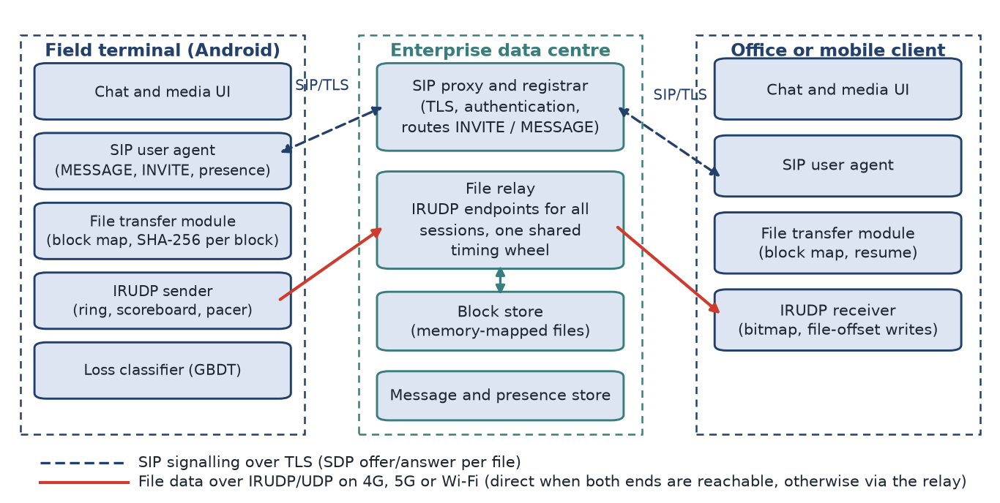
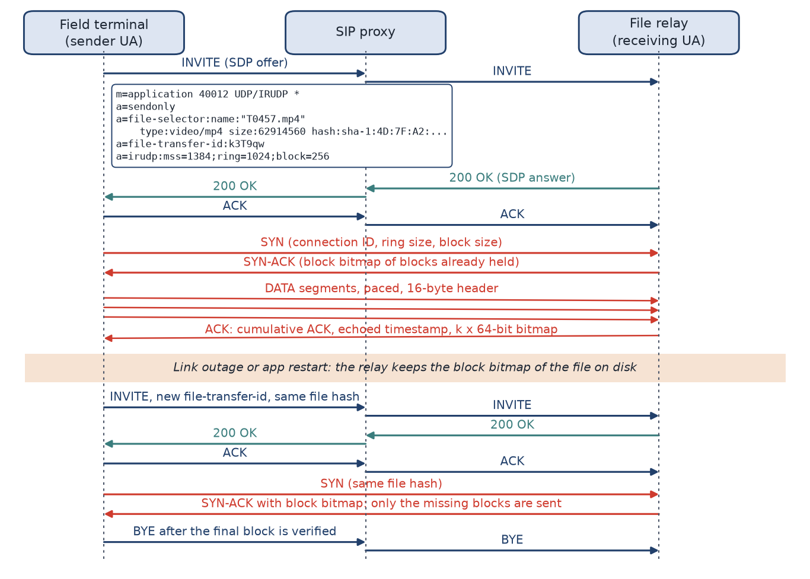
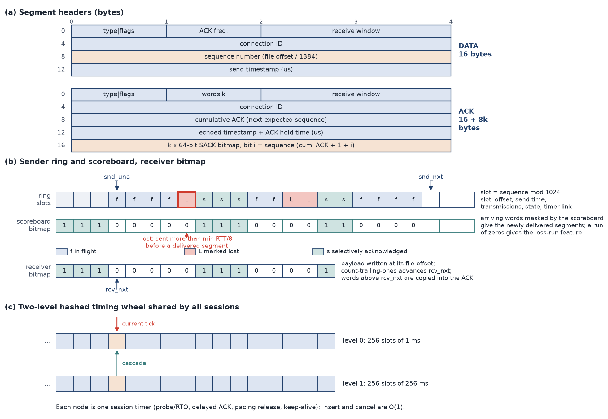
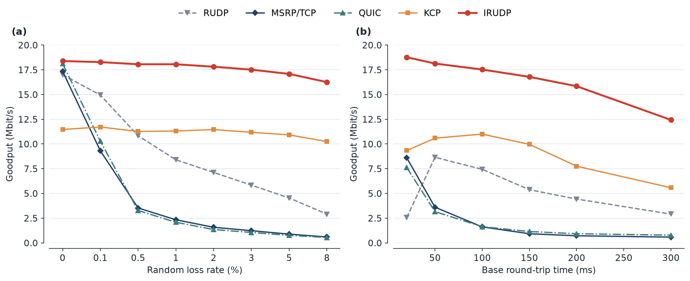
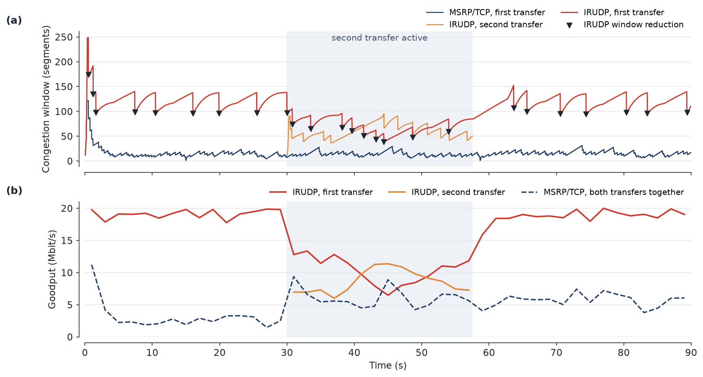
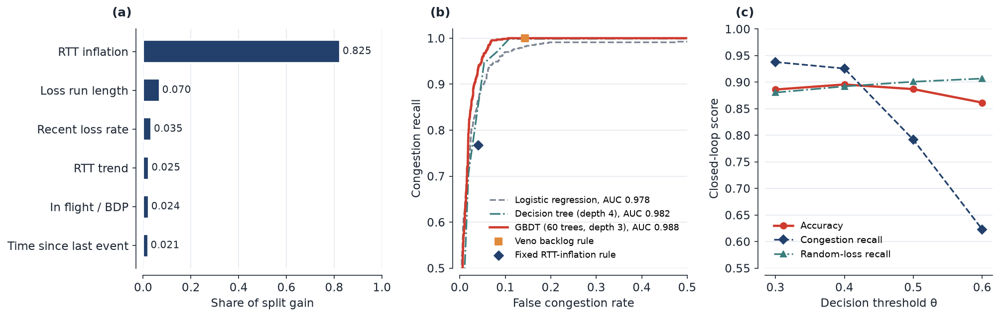
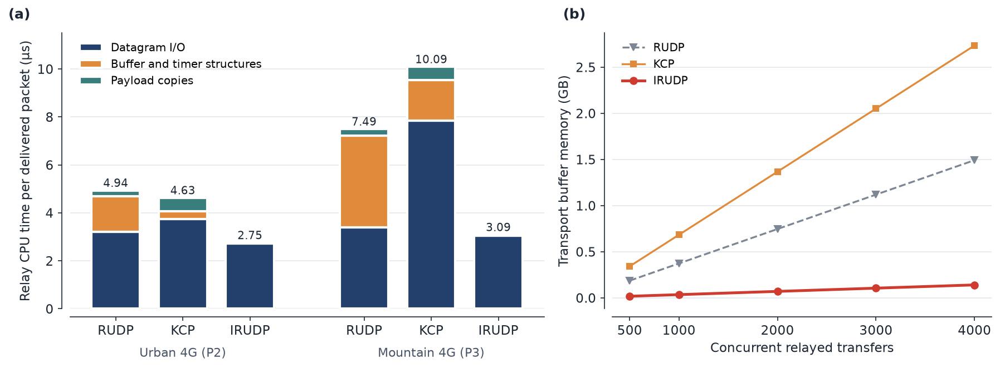
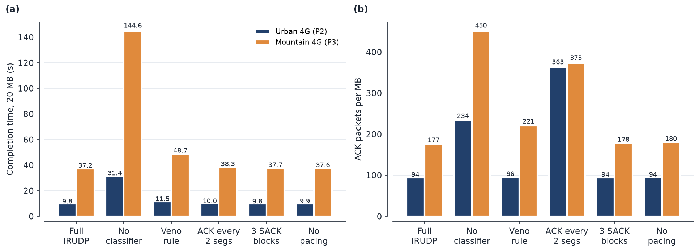
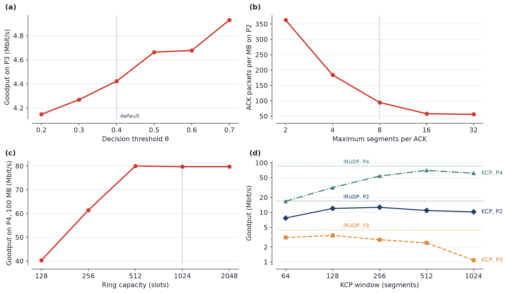

# A Study of Performance Improvement of a File Transfer System Based on an Improved RUDP Protocol Data Structure in a Chat Application Using the SIP Protocol

Zhenyu Gao^a^, Lihua Fan^a,\*^, Kaiwen Tan^b^, Shuyi Peng^a^

^a^ School of Information and Communication Engineering, Hanshui University of Posts and Telecommunications, Xiangyang 441053, China\
^b^ Information and Communication Branch, Qingjiang Grid Maintenance Co., Ltd., Enshi 445000, China

\* Corresponding author. E-mail address: fanlihua@hsupt.edu.cn (L. Fan).

**Teaching example: the authors, institutions, dataset and results in this paper are fictional.**

## Abstract

Chat applications built on the Session Initiation Protocol (SIP) negotiate each file transfer as a session, but the transport that then carries the file decides how long the transfer takes. A grid maintenance company in the mountains of western Hubei uses such an application to send inspection photographs and videos from the field, and its existing transport, a reliable UDP (RUDP) layer derived from an early IETF draft, keeps its send and receive buffers in linked lists, reports out-of-order segments one by one, resends everything when a single timer expires and has no congestion control. This paper proposes IRUDP, an improved RUDP whose data structures are designed for bulk file transfer over lossy mobile links. A 16-byte header carries a sequence number that is also the file offset, a sequence-indexed ring buffer keeps the send time and state of every segment in flight, the receiver writes each segment directly to its file offset and acknowledges with 64-bit bitmap words at an adaptive frequency, one hierarchical timing wheel holds the timers of all sessions at the relay server, and a block bitmap negotiated through SIP and SDP lets an interrupted transfer resume. At each loss event a small gradient-boosted tree classifier, fed with the delay and loss pattern that the ring and the bitmaps record, decides whether the loss came from congestion, and the CUBIC window is reduced only when it did. In packet-level simulation over five link profiles measured in the deployment area, IRUDP reduced the completion time of a 20 MB file by 36.8% on average compared with the previous RUDP layer, by 68.4% compared with MSRP over TCP, by 67.1% compared with QUIC and by 31.5% compared with KCP, while retransmitting about as much as each link lost, against 6.1% to 196.2% of the file for KCP. The gain in speed comes from the gated window reduction: the classifier reached an accuracy of 0.957 and an F1 score of 0.834 on held-out scenarios and an accuracy of 0.890 in closed loop. The data structures cut the cost: at the relay, the work spent on buffers and timers fell from 1,471 ns to 29 ns per delivered packet, the processor time per Gbit/s fell by 44.3% and the transport buffer memory per transfer by 90.6%. In a six-week field trial the median completion time of a transfer fell from 4.10 s to 3.02 s. The results indicate that a reliable UDP transport whose data structures are built for bulk transfer, combined with a learned decision on when to back off, gives a file transfer system for SIP-based chat that is faster on weak links and cheaper to serve.

*Keywords:* Session Initiation Protocol; Reliable UDP; File transfer; Data structure; Selective acknowledgement bitmap; Timing wheel; Loss differentiation; Gradient boosting

## 1. Introduction

Instant messaging has become the working channel of many Chinese enterprises, and file sharing is one of its most used functions. Where messaging is built on telecommunication standards, the Session Initiation Protocol (SIP) [1] establishes and ends the sessions, the SIP MESSAGE method [2] carries short text, and a file is offered and accepted through a Session Description Protocol (SDP) exchange [3] and then carried by the Message Session Relay Protocol (MSRP) over TCP [4]. The same family of protocols underlies 5G Messaging, which Yang et al. [5] describe as deployed by more than 90 mobile operators serving over 421 million monthly active users through 1.2 billion devices; in that system a file is uploaded to an HTTP content server and fetched by the recipient. Operators have had to engineer these platforms for scale. Jia [6], of the Beijing Research Institute of China Telecom, reorganized the SIP registration and message processes of a 5G RCS system and reported a ten-fold faster processing speed and an eight-fold higher load capacity than the original system.

The links over which files are sent are often poor. Field staff of utilities work in mountains where 4G coverage is weak, the radio link loses packets in bursts and the connection disappears for seconds at a time. TCP, and therefore MSRP, reads every loss as a sign of congestion. CUBIC, the default congestion control of the Linux, Windows and Apple stacks, is loss-based like Reno and reduces its window by 30% at each loss event [7], so random losses on a radio link keep the window small. Dong et al. [8] note that the performance of TCP can be as much as ten times below the optimum under non-congestion loss. Chinese developers have answered with transports built on UDP. KCP [9], a widely used ARQ library, claims a 30% to 40% lower average latency than TCP at the cost of 10% to 20% more bandwidth, Alibaba tested multipath QUIC for its short videos with over 100,000 users of the Taobao app [10], and ByteDance and Tencent have studied loss recovery for QUIC and for cloud gaming [11, 12].

The application studied in this paper, an enterprise chat client used by a grid maintenance company in the Enshi area of western Hubei, already sends files over a reliable UDP layer. Its design follows the Reliable UDP draft [13], extended to 32-bit sequence numbers. That design was intended for signalling traffic, and it shows when large files are sent. Unacknowledged segments are kept in a linked list that is searched for each out-of-order acknowledgement, the receiver lists out-of-order segments one by one in extended acknowledgements, a single 600 ms timer resends every unacknowledged segment when it expires, and there is no congestion control. KCP, which the company also tested, keeps its buffers in linked lists as well, sends a 24-byte acknowledgement segment for every data segment and scans its whole send buffer at every update interval [9]. In both designs much of the cost of the transport lies in its data structures. List searches grow with the window, acknowledgement traffic grows with the packet rate, and periodic polling grows with the number of sessions held by the relay server that forwards files between terminals. Timer facilities built on lists have the same weakness, and timing wheels were proposed to remove it [14].

This paper therefore treats the data structures of the transport as the object to be improved, and pairs them with a learned decision on when the window should shrink. We replace the lists with structures indexed by sequence number and shared across sessions, and we read the send time and fate of every segment from these structures to let a small classifier decide whether a loss calls for a smaller window.

The main contributions of this paper are summarized as follows.

(1) An analysis of the data structures of the RUDP layer used by the application and of KCP, which shows where their processing, acknowledgement and memory costs come from, together with a SIP and SDP negotiation that carries the parameters of a new transport and supports the resumption of interrupted transfers.

(2) IRUDP, an improved RUDP with a 16-byte header, a sequence-indexed ring buffer and scoreboard, a receiver bitmap acknowledged in 64-bit words at an adaptive frequency, a two-level timing wheel shared by all sessions of a relay, a block bitmap for resumable transfer, and a gradient-boosted tree classifier that gates the CUBIC window reduction.

(3) An evaluation against MSRP over TCP, QUIC, KCP and the previous RUDP layer on five link profiles measured in the deployment area, with a classifier study, fairness and outage tests, a relay cost analysis, an ablation and sensitivity study, and a six-week field trial.

The remainder of the paper is organized as follows. Section 2 reviews related work. Section 3 describes the application and analyses the costs of the existing transports. Section 4 presents IRUDP. Section 5 reports the experiments, Section 6 discusses the results and their limitations, and Section 7 concludes the paper.

## 2. Related work

### 2.1 SIP-based messaging and file transfer

SIP [1] is a text-based signalling protocol that creates, modifies and ends sessions between user agents, usually through proxy servers that route requests and registrars that map users to addresses. Instant messages can be sent in pager mode with the MESSAGE method [2], or in session mode, in which an INVITE sets up an MSRP session [4]. MSRP runs over TCP or TLS and splits large messages into chunks that can be interrupted when other traffic is waiting. RFC 5547 [3] defines SDP attributes that describe a file to be sent or received, including its name, type, size and hash, a transfer identifier that distinguishes repeated offers, and a byte range that allows a partial transfer to be resumed; a resumed transfer counts as a new transfer and carries a new identifier. The standards leave the transport free in principle, since the SDP media line names the protocol, but in practice the file data is carried by MSRP. Large deployments have moved away from session-mode file transfer: in 5G Messaging the sending terminal uploads the file to a content server over HTTP and the recipient receives a download descriptor [5]. Operator work in China has concentrated on signalling capacity, as in the regional clustering and load balancing of Jia [6].

The transfer of large files over unstable links has been studied mainly outside messaging. Cao [15] split ocean observation files into segments whose size adapts to network conditions and resumed interrupted transfers from the break point, reporting a speed between 50 and 100 MB/s against 20 to 50 MB/s for a traditional system. Yu et al. [16] proposed a probabilistic retransmission method for satellite-to-ground file transfer that detects link-state changes from the latency distribution, and reported that it reduced the transmission time by 4.48% to 32.46% and the retransmission rate by 20.32% to 83.79%. Neither study concerns the signalling of a chat application or the cost of serving many transfers at once.

### 2.2 Reliable transport over UDP

The Reliable UDP draft of Bova and Krivoruchka [13] defines a six-octet header with one-octet sequence and acknowledgement numbers, extended acknowledgement (EACK) segments that list out-of-sequence segments, keep-alive and reset segments, and negotiable timers. It recommends a 600 ms retransmission timer, on whose expiry all unacknowledged segments are resent, and a receive queue of 32 packets, and it states that RUDP provides no congestion control or slow start. UDT [17] introduced a UDP-based protocol for bulk transfer over high bandwidth-delay paths. KCP [9], widely used in China for games and real-time applications, has a 24-byte header that carries a cumulative acknowledgement, acknowledges each data segment with its own 24-byte segment, and in turbo mode disables congestion control, lowers the minimum retransmission timeout to 30 ms and grows the timeout by a factor of 1.5 instead of 2. Its queues and buffers are intrusive doubly linked lists, and the flush routine walks the whole send buffer at every interval.

QUIC [18], now the main general-purpose transport over UDP, numbers packets monotonically, acknowledges ranges of packets and carries several encrypted streams. Chinese platforms have extended it. XLINK [10] drives multipath scheduling of Taobao short videos with quality-of-experience signals, and in A/B tests with over 100,000 volunteers it improved the 99th-percentile request completion time by 19% to 50% at the expense of 2.1% redundant traffic. Li et al. [11] measured more than 200,000 QUIC connections on a public cloud, found that only 37.2% of loss events lost a single packet, and proposed adaptive retransmission that reduced the flow completion time by up to 34%. Hairpin [12] plans data, retransmissions and redundancy across rounds for edge cloud gaming and reduced the bandwidth cost by 40% and the deadline miss rate by 32% on average in the wild. In industry, Zhao et al. [19] added CRC checks, transaction identifiers, retransmission and backoff to a UDP-based Modbus gateway and raised the success rate to more than 98%, against 77.4% for plain Modbus over UDP. These works improve the protocol logic of reliable UDP, while its data structures receive little attention.

### 2.3 Data structures and timers in transport implementations

The cost of a timer facility depends on its data structure. Varghese and Lauck [14] showed that conventional timer modules take O(n) time to start or maintain a timer, whereas a timing wheel starts, stops and maintains timers in O(1) time within its range, and they described hashed and hierarchical wheels that support thousands of outstanding timers. TCP computes its retransmission timeout from a smoothed round-trip time and its variance [20]. RACK-TLP [21] detects losses from the transmit time of each segment and the selective acknowledgements, which handles lost retransmissions and reordering better than a duplicate-acknowledgement threshold, and it notes that an implementation can multiplex its timers into one timer per connection with a variable that records which event is pending. Production systems have redesigned their per-packet state for scale. Alibaba's user-space stack Luna cut the average I/O latency by more than 64%, and its successor Solar, a UDP-based storage protocol whose packets each carry a self-contained block so that no reassembly buffer is needed, runs on about 100,000 servers and raised the throughput of a single core by up to 78% [22]. Huang et al. [23] noted that an earlier RDMA design keeps five bitmaps of 500 slots per connection for selective retransmission, which for 5,000 connections takes 1.5 MB of the scarce memory on a network card, and reduced the state to about 10 bits per connection while keeping over 92% of the throughput at a loss rate of 1%. In host memory, a bitmap sized to the window is cheap.

### 2.4 Learning-assisted loss differentiation and congestion control

Since loss-based congestion control misreads random loss [7], many schemes have tried to tell the two kinds of loss apart or to avoid the loss signal altogether. PCC Vivace [8] turns throughput, loss and latency into a utility and adjusts the sending rate by online gradient ascent. Wei et al. [24] selected relative one-way delay, inter-arrival statistics and the number of consecutive lost packets as features and combined a support vector machine, a decision tree, logistic regression and nearest neighbours to classify losses in low Earth orbit satellite networks, improving accuracy by 4.37% and throughput by 9.28% over an earlier ensemble. Chen et al. [25] built a small quantized network that diagnoses wireless loss inside the Linux kernel for rule-based controllers, with a CPU overhead of around 1% against around 100% for learning-based controllers such as Aurora and Vivace. Spine [26] keeps a cheap per-packet controller and lets a reinforcement-learning policy update its parameters only occasionally, so that a single flow uses 2.6% of a CPU, against 131.5% for Aurora and 1.1% for CUBIC.

Two gaps remain for a SIP-based chat application. First, the reliable UDP transports used in practice keep their buffers in lists and acknowledge segment by segment, and the cost of these choices at a relay that serves thousands of transfers has not been measured. Second, learned loss classifiers have been attached to kernel TCP or evaluated in simulation, but not combined with a transport whose structures already record the send time and fate of every segment. This paper addresses both gaps.

## 3. System description and problem analysis

### 3.1 The chat application

Fig. 1 shows the application. About 430 field staff of the company carry Android terminals with a chat client whose SIP user agent registers with a SIP proxy and registrar in the company's data centre in Enshi over TLS. Text messages are sent with the MESSAGE method, presence is published through the same proxy, and files are offered with an INVITE whose SDP describes the file. The terminals send inspection photographs of 1.5 to 8 MB, inspection videos of 12 to 160 MB and documents, mostly from transmission line corridors in the mountains. A file goes directly to the recipient when both ends are reachable and otherwise through a file relay in the data centre, which stores the blocks it receives and forwards them to the recipient, also when the recipient comes online later. The relay terminates a transport session for each upload and for each download.



Fig. 1. Architecture of the SIP-based chat application with the IRUDP file transfer module.

### 3.2 Signalling of a file transfer

Fig. 2 shows the signalling of one transfer between a terminal and the relay. The offer follows RFC 5547 [3] and names the transport in the media line. The `file-selector` attribute gives the name, type, size and SHA-1 hash of the file, the hash algorithm that the RFC specifies, the `file-transfer-id` attribute identifies the transfer, and a private `irudp` attribute gives the segment payload size, the ring capacity and the number of segments in a block. After the 200 OK and the ACK, the transport opens its own connection with a SYN and a SYN-ACK, and the SYN-ACK of the receiving side carries the bitmap of the blocks it already holds for the file with that hash. After an outage or a restart of the application, the sender offers the same file again in a new INVITE. As RFC 5547 requires for a resumed transfer, the offer carries a new transfer identifier, and the receiving side recognizes the file by its hash and returns its block bitmap, so that the transfer resumes instead of starting again. The SIP signalling is the same for all the transports compared in this paper except for the media line, and only the transport that carries the data differs.



Fig. 2. SIP signalling of a file transfer and of its resumption after an interruption.

### 3.3 Costs of the existing data structures

Three costs dominate the existing transports, and all three come from their data structures. The first is the work of keeping buffers and timers. KCP walks its whole send buffer at each flush to find segments to send, segments whose timer has expired and segments to fast-retransmit [9]. With $\bar W$ segments in flight and a flush interval $\Delta$, the number of list nodes visited per second by one session is
$$n_{\mathrm{scan}}=\frac{\bar W}{\Delta},\qquad(1)$$
which for a window of 256 segments and an interval of 10 ms is 25,600 visits per second, whether or not anything has changed. The RUDP layer of the application has no periodic scan, but every EACK makes it search the retransmission list once for each listed segment and walk the list again to find the missing segments, so that its cost per acknowledgement grows with the window and with the number of holes.

The second cost is acknowledgement traffic. An acknowledgement entry of KCP is a 24-byte segment for each data segment of 1,376 bytes, packed up to the 1,400-byte maximum transfer unit. The ratio of acknowledgement bytes to data bytes is then
$$\eta_{\mathrm{KCP}}=\frac{24+28/m}{1376},\qquad \eta_{\mathrm{IRUDP}}=\frac{44+8k}{n_a\cdot 1384},\qquad(2)$$
where $m$ is the number of entries per acknowledgement datagram and 28 bytes are the IPv4 and UDP headers, while for IRUDP, introduced in Section 4, one acknowledgement of $44+8k$ bytes with $k$ bitmap words covers $n_a$ data segments. With $m=58$ and $n_a=8$ the ratios are 1.78% and 0.40% when no bitmap word is needed. The RUDP layer sends a 40-byte acknowledgement every three segments and an EACK of 4 bytes per out-of-order segment, so that its acknowledgement traffic grows with the loss rate.

The third cost is memory. Both list-based designs allocate a buffer for each segment that holds a copy of the payload, so that the memory of a sending session is
$$M_{\mathrm{list}}=(\bar W+Q)(s+h),\qquad M_{\mathrm{ring}}=C\,s_{\mathrm{slot}}+\frac{2C}{8}+M_0,\qquad(3)$$
where $Q$ is the number of segments queued by the application, $s$ the payload size and $h$ the header and list overhead of a segment, while the ring of IRUDP has $C$ slots of $s_{\mathrm{slot}}$ bytes without payload, two bitmaps and a fixed session state $M_0$, since the payload stays in the file. The RUDP layer also has two problems of protocol rather than structure: its single timer resends every unacknowledged segment on expiry, and its fixed window either wastes a fast link or overflows a slow one. Table 1 summarizes the transports.

Table 1. Transports compared in this paper.

| Transport | Header (bytes) | Loss feedback | Timers | Congestion control | Buffers |
|------------|--------|--------------|------------|------------|------------|
| MSRP/TCP | 32 | 3 SACK blocks | One RTO | CUBIC | Kernel queues |
| QUIC | about 35 | ACK ranges | Probe timeout | CUBIC, paced | Library queues |
| KCP (turbo) | 24 | 24-byte entry per segment | Scan every 10 ms | None | Linked lists |
| RUDP (previous) | 12 | EACK list | 600 ms, resend all | None | Linked lists |
| IRUDP | 16 | 64-bit bitmap words | Shared wheel | Gated CUBIC, paced | Ring and bitmaps |

## 4. The proposed IRUDP transport

### 4.1 Overview

IRUDP keeps the protocol model of RUDP, namely connections opened with SYN segments, cumulative and selective acknowledgements and keep-alive segments, and replaces the data structures behind it. The sender keeps the state of every segment in flight in a ring indexed by sequence number, the receiver keeps a bitmap and writes each payload to its offset in the file, the acknowledgement carries words of that bitmap, and the timers of all sessions of a process live in one wheel. Above the transport, the file module keeps a block bitmap and the hash of each block. The window is controlled by CUBIC [7], and a classifier decides at each loss event whether the reduction applies. Fig. 3 shows the formats and structures.



Fig. 3. Data structures of IRUDP: (a) segment headers, (b) the sender ring with its scoreboard and the receiver bitmap, and (c) the two-level timing wheel.

### 4.2 Segment formats

A data segment has a 16-byte header, shown in Fig. 3(a). The first byte holds the version, the segment type and three flags, the second byte holds the acknowledgement frequency requested from the receiver, and two bytes carry the receive window. A 4-byte connection identifier, chosen by the sender and carried in the SYN, lets a session survive a change of address, for example from Wi-Fi to 4G. The 4-byte sequence number counts segments of 1,384 bytes, so that the payload of segment $s$ belongs at byte offset $1384\,s$ of the file and no offset field is needed. The last 4 bytes hold the send time in microseconds. With a 1,400-byte UDP payload, which avoids fragmentation on the tunnels of the mobile operators in the area, a segment carries 1,384 bytes of data. An acknowledgement segment has the same first 8 bytes, with the number of bitmap words $k$ in the second byte, followed by the cumulative acknowledgement, the echoed send time and $k$ 64-bit words. Bit $b$ of word $w$ reports segment $a+1+64w+b$, where $a$ is the cumulative acknowledgement, so that 16 words cover the 1,024 segments of the ring.

### 4.3 Sender ring and scoreboard

The sender keeps a ring of $C=1024$ slots. Segment $s$ occupies the slot
$$i(s)=s \bmod C = s \;\&\; (C-1),\qquad(4)$$
which holds its byte offset, the time of its last transmission, its number of transmissions, its state (in flight, selectively acknowledged, marked lost or free) and the link of its node in the timing wheel. Since every slot is found by a mask, a cumulative acknowledgement frees slots in order and a bitmap word is processed in a time proportional to its new set bits, without any search. A scoreboard bitmap, the integer `board` of Listing 1, records which segments above the cumulative acknowledgement have already been delivered, so that bits repeated by later acknowledgements are masked out, and bits outside the window are ignored. When an acknowledgement arrives, the sender records the send time $\tau_{\mathrm{rack}}$ of the most recently sent segment that it acknowledges, and marks as lost every segment still in flight whose send time satisfies
$$\tau_s+\frac{R_{\min}}{8}<\tau_{\mathrm{rack}},\qquad(5)$$
where $R_{\min}$ is the minimum round-trip time. This is the time-based rule of RACK [21] with a reordering window of one eighth of the round-trip time, and it detects a lost retransmission as easily as a lost original because every transmission has its own send time. Listing 1 shows the ring.

**Listing 1.** Sender ring and scoreboard.

```python
CAP = 1024                                   # ring capacity (power of two)
FREE, INFLIGHT, SACKED, LOST = 0, 1, 2, 3

class SendRing:
    def __init__(self):
        self.state = bytearray(CAP)          # per-slot state
        self.sent_at = [0.0] * CAP           # per-slot send time (us)
        self.tx = bytearray(CAP)             # transmissions of the slot
        self.una = 0                         # oldest unacknowledged sequence
        self.nxt = 0                         # next new sequence
        self.board = 0                       # scoreboard: bit j set = segment una + j delivered
        self.rack_ts = -1.0                  # send time of the latest delivered segment

    def send(self, seq, now):
        i = seq & (CAP - 1)                  # Eq. (4): slot index
        self.state[i] = INFLIGHT; self.sent_at[i] = now; self.tx[i] += 1
        self.nxt = max(self.nxt, seq + 1)

    def _deliver(self, seq):
        i = seq & (CAP - 1)
        if self.una <= seq < self.nxt and self.state[i] in (INFLIGHT, LOST):
            self.state[i] = SACKED
            self.rack_ts = max(self.rack_ts, self.sent_at[i])
            return 1
        return 0

    def on_ack(self, cum, words):
        """cum: next expected sequence; words: 64-bit ints, bit b of word w = cum + 1 + 64w + b."""
        if cum < self.una:
            return 0                         # stale or reordered acknowledgement
        newly = 0
        while self.una < min(cum, self.nxt):     # cumulative part frees slots in order
            newly += self._deliver(self.una)
            i = self.una & (CAP - 1)
            self.state[i] = FREE; self.tx[i] = 0
            self.una += 1; self.board >>= 1
        for w, word in enumerate(words):     # selective part, one 64-bit word at a time
            shift = 1 + 64 * w
            room = self.nxt - (cum + shift)              # bits at or beyond nxt are outside the window
            if room <= 0:
                break
            word &= ~(self.board >> shift) & ((1 << min(room, 64)) - 1)   # new bits in the window only
            self.board |= word << shift
            while word:
                b = (word & -word).bit_length() - 1      # lowest set bit
                newly += self._deliver(cum + shift + b)
                word &= word - 1
        return newly

    def mark_lost(self, min_rtt):
        """Eq. (5): a segment sent more than min_rtt/8 before a delivered one is lost."""
        lost = []
        for seq in range(self.una, self.nxt):
            i = seq & (CAP - 1)
            if self.state[i] == INFLIGHT and self.sent_at[i] + min_rtt / 8 < self.rack_ts:
                self.state[i] = LOST; lost.append(seq)
        return lost
```

The loop of `mark_lost` is written over the whole window for clarity. The implementation keeps the slots in flight in order of transmission time and stops at the first slot that is not yet late, so that the work per acknowledgement is proportional to the number of newly marked segments. Each session has one loss-recovery timer, a simplification that RACK-TLP [21] allows. Its timeout uses the estimator of RFC 6298 [20] with a floor of 200 ms instead of 1 s, as in common TCP implementations, and an added acknowledgement delay, as in QUIC:
$$\mathrm{RTO}=\max\left(\mathrm{SRTT}+\max(G,\,4\,\mathrm{RTTVAR})+D_{\mathrm{ack}},\ \mathrm{RTO}_{\min}\right),\qquad(6)$$
with a clock granularity $G$ of 1 ms, the maximum acknowledgement delay $D_{\mathrm{ack}}=10$ ms and $\mathrm{RTO}_{\min}=200$ ms. The timer is restarted by every acknowledgement that delivers new data. When it fires, the oldest segment in flight is marked lost and resent as a probe, even when the window is full, and the timeout grows by a factor of 1.5 up to 2 s. These are two further departures from RFC 6298, which doubles the timeout and allows no maximum below 60 s, and they let a terminal probe a dead link gently and still notice within 2 s that the link has returned. Three expiries in a row without any delivery are treated as persistent congestion and set the window to two segments.

### 4.4 Receiver bitmap and acknowledgements

The receiver does not reorder segments in memory. It writes each payload at offset $1384\,s$ of a memory-mapped file, sets bit $s$ of its bitmap and advances its next expected segment $r$ over the run of set bits, which a word-level count of trailing ones does in a few instructions. A duplicate is recognized by its bit and acknowledged at once. The acknowledgement carries $r$ as the cumulative acknowledgement and the words of the bitmap above $r$ up to the last set bit, at most 16. The sender asks for one acknowledgement every
$$n_a=\min\left(\max\left(\left\lfloor \frac{W}{8}\right\rfloor,\,2\right),\,8\right)\qquad(7)$$
segments through the acknowledgement frequency byte, where $W$ is its congestion window, so that a small window still receives frequent feedback. The receiver also acknowledges at once when a new gap appears or a gap is filled, and after at most 10 ms otherwise. Since the bitmap repeats the whole state, the loss of an acknowledgement costs no information. The echoed send time is advanced by the time for which the receiver held the acknowledgement, so that the sender measures the round-trip time without the acknowledgement delay. Listing 2 shows the receiver.

**Listing 2.** Receiver bitmap and acknowledgement words.

```python
class RecvBitmap:
    def __init__(self, nseg):
        self.bits = bytearray((nseg + 7) // 8)
        self.rcv_nxt = 0
        self.nseg = nseg

    def _get(self, s):
        return (self.bits[s >> 3] >> (s & 7)) & 1

    def on_data(self, seq, payload, fileobj, mss=1384):
        if seq >= self.nseg or self._get(seq):
            return False                      # duplicate
        fileobj.seek(seq * mss); fileobj.write(payload)      # no reordering buffer
        self.bits[seq >> 3] |= 1 << (seq & 7)
        while self.rcv_nxt < self.nseg and self._get(self.rcv_nxt):
            self.rcv_nxt += 1                 # count trailing ones
        return True

    def ack_words(self, kmax=16):
        big = int.from_bytes(self.bits, 'little') >> (self.rcv_nxt + 1)   # bit i: rcv_nxt + 1 + i
        words = [(big >> (64 * w)) & (2 ** 64 - 1) for w in range(kmax)]
        while words and words[-1] == 0:       # k = number of words up to the last set bit
            words.pop()
        return self.rcv_nxt, words
```

### 4.5 Shared timing wheel

A relay holds thousands of sessions, each with a retransmission timer, a delayed acknowledgement timer, a pacing release time and a keep-alive timer. IRUDP keeps all of them in one two-level hashed timing wheel [14], shown in Fig. 3(c). Level 0 has 256 slots of 1 ms and level 1 has 256 slots of 256 ms, which covers 65.5 s, enough for the keep-alive and idle timers. Starting and cancelling a timer are O(1), a tick visits one slot, every 256 ms one slot of level 1 is redistributed to level 0, a timer that is already due fires at the next tick, and a callback may cancel or restart other timers, even those due in the same tick. An idle session costs nothing, whereas KCP updates every session every 10 ms. Listing 3 shows the wheel.

**Listing 3.** Two-level hashed timing wheel.

```python
class TimingWheel:
    def __init__(self, n0=256, n1=256):
        self.n0, self.n1 = n0, n1
        self.l0 = [dict() for _ in range(n0)]   # slot -> {timer_id: (expiry, callback)}
        self.l1 = [dict() for _ in range(n1)]
        self.now = 0                            # current tick (ms)
        self.where = {}                         # timer_id -> slot dict, for O(1) cancel

    def start(self, tid, expiry, cb):
        self.cancel(tid)
        exp = max(expiry, self.now + 1)         # a timer that is already due fires at the next tick
        if exp - self.now < self.n0:
            slot = self.l0[exp % self.n0]
        else:                                   # range of the wheel: n0 * n1 ticks (65.5 s)
            slot = self.l1[(exp // self.n0) % self.n1]
        slot[tid] = (exp, cb); self.where[tid] = slot

    def cancel(self, tid):
        slot = self.where.pop(tid, None)
        if slot is not None:
            slot.pop(tid, None)

    def tick(self):
        self.now += 1
        if self.now % self.n0 == 0:             # every 256 ms, move one level-1 slot down to level 0
            moved = self.l1[(self.now // self.n0) % self.n1]
            for tid, (exp, cb) in list(moved.items()):
                del moved[tid]
                slot = self.l0[exp % self.n0]   # exp lies in [now, now + 256): its own level-0 slot
                slot[tid] = (exp, cb); self.where[tid] = slot
        due = self.l0[self.now % self.n0]
        for tid in list(due):
            entry = due.get(tid)                # may have been cancelled by an earlier callback
            if entry is None or entry[0] > self.now:
                continue
            del due[tid]; self.where.pop(tid, None)
            entry[1](tid)
```

### 4.6 Block map and resumable transfer

The file module groups 256 segments into a block of 354,304 bytes and computes the SHA-256 digest of every block before the transfer. The digests travel in a manifest that is the first object of the transfer, so that the receiver can check each block as it completes and ask again for a corrupted block by its number. The receiver keeps one bit per block, writes the block bitmap to a small file next to the partial file after each completed block, and returns it in the SYN-ACK of a resumed transfer, as in Fig. 2. A 150 MB video has 424 blocks, so the bitmap fits in 53 bytes. Because the sequence number is the file offset, the sender of a resumed transfer skips the blocks already held and resends the incomplete ones, which costs at most the blocks that were incomplete when the transfer stopped. Since the incomplete segments lie within the $C=1024$ slots of the ring, these are at most $\lceil C/256\rceil+1=5$ blocks. The relay keeps the block bitmaps of the files it stores, so an upload resumes even after the relay or the terminal has restarted.

### 4.7 Loss classification and window control

The window grows and shrinks according to CUBIC [7]. After a reduction at window $W_{\max}$, the window follows
$$W(t)=C_c\,(t-K)^3+W_{\max},\qquad K=\sqrt[3]{\frac{W_{\max}(1-\beta)}{C_c}},\qquad(8)$$
with $C_c=0.4$ and $\beta=0.7$, together with the Reno-friendly estimate of RFC 9438 and fast convergence. Slow start ends when the minimum of the last eight round-trip samples exceeds $R_{\min}$ by $\min(\max(R_{\min}/8,\,4\ \mathrm{ms}),\,16\ \mathrm{ms})$. Sending is paced at $g\,W\,s_w/\mathrm{SRTT}$, where $s_w$ is the size of a segment on the wire and $g$ is 2 in slow start and 1.25 afterwards.

At the first loss of each window of data, the sender computes six features from its structures:
$$\mathbf{x}=\left(\frac{R_{\mathrm{lat}}-R_{\min}}{R_{\min}},\ \frac{\bar R_{\mathrm{new}}-\bar R_{\mathrm{old}}}{R_{\min}},\ L_{\mathrm{run}},\ 100\,\ell,\ \frac{F}{\hat B\,R_{\min}},\ \min\left(\frac{t-t_{\mathrm{last}}}{\mathrm{SRTT}},\,50\right)\right),\qquad(9)$$
namely the inflation of the latest round-trip time, the trend of the round-trip time (the mean of the last four samples against the mean of the twelve before them), the length of the run of consecutive lost segments in the scoreboard, a moving average $\ell$ of the loss indicator per segment with weight 0.01, the number of segments in flight $F$ relative to the estimated bandwidth-delay product, where $\hat B$ is the maximum delivery rate over the last ten round trips, and the time since the previous loss event. The ring, the scoreboard and the round-trip samples provide all six without a search. A gradient-boosted tree model of $M=60$ trees of depth 3, fitted with second-order (Newton) steps on the logistic loss as in XGBoost [27], gives the probability that the loss came from congestion,
$$p(\mathbf{x})=\sigma\left(F_0+\nu\sum_{m=1}^{M}f_m(\mathbf{x})\right),\qquad(10)$$
where $\sigma$ is the logistic function, $F_0$ the log-odds of congestion in the training data and $\nu=0.15$ the learning rate. Each tree is fitted to the gradient and Hessian of the logistic loss with 31 quantile thresholds (32 bins) per feature, an L2 penalty of 1 on the leaf values and at least 40 samples per leaf. The window is reduced only if
$$p(\mathbf{x})\ge\theta,\qquad(11)$$
with $\theta=0.4$, in which case $W\leftarrow\max(\beta W,\,2)$ and a new CUBIC epoch starts. Otherwise the window is kept, the lost segments are retransmitted and no further decision is taken until the window of data sent before the loss has been acknowledged. An evaluation costs 180 comparisons and runs in well under a microsecond. Listing 4 shows the features and the decision, and Algorithm 1 gives the processing of an acknowledgement.

**Listing 4.** Loss features and the gated window reduction.

```python
def loss_features(lat_rtt, min_rtt, rtts, lost_run, loss_ewma, inflight, btl_rate, gap, srtt):
    q = (lat_rtt - min_rtt) / min_rtt                           # Eq. (9), RTT inflation
    trend = (sum(rtts[-4:]) / 4 - sum(rtts[:-4]) / (len(rtts) - 4)) / min_rtt if len(rtts) >= 8 else 0.0
    bdp = btl_rate * min_rtt
    sat = inflight / bdp if bdp > 0 else 1.0
    return (q, trend, float(lost_run), 100 * loss_ewma, sat, min(gap / srtt, 50.0))

def on_loss_event(cwnd, features, model, theta=0.4, beta=0.7):
    p = model(features)                                         # P(congestion), Eq. (10)
    if p >= theta:                                              # Eq. (11)
        return max(cwnd * beta, 2.0), True                      # reduce, start a new CUBIC epoch
    return cwnd, False                                          # random loss: keep the window
```

```
Algorithm 1. Acknowledgement processing of the IRUDP sender
Input:  ACK (cumulative a, bitmap words, echoed time e); ring; model; theta
Output: updated ring, window W and timers
1:  take the RTT sample now - e; update SRTT, RTTVAR, R_min and RTO, Eq. (6)
2:  free the slots below a and mark the segments of the set bits as delivered (Listing 1)
3:  if new data was delivered: restart the session timer; update delivery rate
4:  mark slots in flight that satisfy Eq. (5) as lost; queue them for resending
5:  if a lost segment lies beyond the last decision window:
6:      compute x by Eq. (9) and p(x) by Eq. (10)
7:      if p(x) >= theta: W <- max(beta * W, 2); new CUBIC epoch; open recovery
8:      start a new decision window at the next sequence number
9:  if delivered and not in recovery: grow W by slow start or Eq. (8)
10: send retransmissions, then new segments, paced, while in flight < W
```

### 4.8 Complexity and memory

Table 2 compares the cost of the main operations. The list-based designs pay in proportion to the window for searches and scans, while IRUDP pays a constant per segment and a constant per bitmap word. A sending session of IRUDP needs a ring of 1,024 slots of 32 bytes, two bitmaps of 128 bytes and about 2 KB of session state, 35,072 bytes in all, independent of the window and of the file. The payload is read from and written to the file mapping, so it is held once in the page cache and is never copied in user space.

Table 2. Cost of the main operations for a window of $W$ segments, $h$ holes and $N$ sessions.

| Operation | RUDP (previous) | KCP | IRUDP |
|----------------|--------------|--------------|--------------|
| Cumulative ACK of one segment | O(1) at list head | O(1) at list head | O(1) slot |
| Selective information for one segment | O(W) search per EACK entry | O(h) search per entry | O(1) per new set bit, 1 word per 64 segments |
| Retransmission check | One timer per session | O(W) scan per 10 ms flush | Time-ordered slots, O(1) per lost segment |
| Timer start or cancel | Sorted list or polling | Polling of all N sessions | O(1) in the shared wheel |
| Out-of-order arrival at the receiver | O(W) sorted insertion and copy | O(W) insertion from the tail and copy | O(1) bit and write at file offset |
| Memory per sending session | $(W+Q)(s+h)$ | $(W+Q)(s+h)$ | $C\,s_{\mathrm{slot}}+C/4+M_0$ |

## 5. Experiments and results

### 5.1 Link profiles and simulation

To compare the transports under the same conditions, we ran them in a packet-level discrete-event simulator that implements each with its own data structures, timers and acknowledgement policy, over a bottleneck with a drop-tail queue. The link profiles were measured during a two-week drive test in July 2026 along the inspection routes of the company, in its offices and on the leased line between Enshi and the provincial data centre in Wuhan. Each profile is described by the bottleneck rate, the base round-trip time, the buffer size, the random loss rate and its mean burst length, and the variability of the rate, as listed in Table 3. Random losses follow a two-state Gilbert model with the given mean and burst length. The rate of the mobile profiles is multiplied every 100 ms by $\exp(\sigma z-\sigma^2/2)$, where $z$ follows a first-order autoregressive process with coefficient 0.8 and unit variance, clipped to between 0.2 and 2.5 times the mean. The reverse path has twice the rate of the forward path and a quarter of its loss rate. A drop at the queue is a congestion loss and a drop of the Gilbert model is a random loss, so the simulator knows the true cause of every loss.

Table 3. Link profiles measured in the deployment area.

| Profile | Rate (Mbit/s) | Base RTT (ms) | Buffer (packets) | Random loss (%) | Mean burst (packets) | Rate variability $\sigma$ |
|----------------|-------|-------|-------|-------|-------|-------|
| P1 Office Wi-Fi | 50 | 20 | 256 | 0.1 | 1.5 | 0.10 |
| P2 Urban 4G | 20 | 60 | 400 | 0.5 | 2.0 | 0.30 |
| P3 Mountain 4G | 6 | 110 | 150 | 3.0 | 3.0 | 0.50 |
| P4 5G SA | 100 | 30 | 1,000 | 0.2 | 2.0 | 0.25 |
| P5 Inter-provincial line | 50 | 70 | 300 | 0.2 | 1.0 | 0 |

### 5.2 Compared methods and settings

Five transports were compared under the same SIP signalling. MSRP/TCP uses CUBIC with the delay-based slow-start exit of Section 4.7, three SACK blocks, RACK-style loss marking with a reordering window of a quarter of the minimum round-trip time, an acknowledgement for every second segment with a 40 ms delayed-acknowledgement timer and a minimum timeout of 200 ms, with 1,448 bytes of payload per segment and 0.6% of MSRP and TLS framing. QUIC uses the same CUBIC, pacing, an acknowledgement every second packet with a maximum delay of 25 ms, up to 32 acknowledgement ranges and a probe timeout, with 1,315 bytes of payload in a 1,350-byte datagram. KCP runs in turbo mode, that is `nodelay=1`, `interval=10`, `resend=2` and `nc=1`, with windows of 256 segments, the setting the company had piloted, and follows the code of the library for its flush, acknowledgement and timeout logic. RUDP is the previous transport of the application, with 32-bit sequence numbers, a fixed window of 128 segments, acknowledgements after three segments or 300 ms, an EACK after three out-of-order segments, a segment named missing by an EACK resent at once but at most once per timer interval, and a 600 ms timer that resends all unacknowledged segments. IRUDP uses the settings of Section 4. The completion time is measured from the INVITE to the arrival of the last byte and includes the SIP offer and answer (one round trip) and the transport handshake, which takes two round trips for TCP with TLS 1.3, one for QUIC, RUDP and IRUDP, and none for KCP. Goodput is the file size divided by the completion time, and where a goodput is given for several runs it is the mean of the per-run values. The comparisons of Sections 5.3 and 5.8 used ten runs with different random seeds for each setting, and the other studies state their number of runs. The classifier of IRUDP was trained before these experiments on separate scenarios, described in Section 5.6.

### 5.3 Completion time on the five profiles

Table 4 gives the completion time of a 20 MB file (20 × 10^6^ bytes). IRUDP was the fastest on every profile. Compared with the previous RUDP layer, it reduced the completion time by 17.6% on P1, 23.9% on P2, 18.9% on P3, 58.7% on P4 and 65.0% on P5, or 36.8% on average. The average reductions compared with MSRP/TCP, QUIC and KCP were 68.4%, 67.1% and 31.5%. The reduction compared with TCP ranged from 31.2% on P1, where little is lost, to 85.7% on P5, where the long and fast path leaves a loss-based window far below the bandwidth-delay product, and on P3 TCP needed 191.05 s with a standard deviation of 52.74 s, while IRUDP needed 36.02 s. The second place went to KCP on P1, P4 and P5 and to the previous RUDP layer on P2 and P3, the two transports that do not reduce their window at a loss. The gap to RUDP was largest on P4 and P5, where its fixed window of 128 segments allows at most about 47 Mbit/s at the 30 ms round trip of P4 and 20 Mbit/s at the 70 ms of P5, and every loss stalled the window until the hole was repaired, so that its mean completion times correspond to 34.9 and 14.3 Mbit/s. The mean completion times of IRUDP correspond to 47.5 Mbit/s on the 50 Mbit/s Wi-Fi profile and 84.7 Mbit/s on the 100 Mbit/s 5G profile.

Table 4. Completion time (s) of a 20 MB file, mean ± standard deviation over ten runs.

| Profile | MSRP/TCP | QUIC | KCP | RUDP | IRUDP |
|----------------|----------|----------|----------|----------|----------|
| P1 Office Wi-Fi | 4.90 ± 0.55 | 4.85 ± 0.81 | 4.06 ± 0.26 | 4.09 ± 0.40 | **3.37 ± 0.12** |
| P2 Urban 4G | 30.65 ± 3.10 | 33.10 ± 3.90 | 12.61 ± 0.77 | 12.49 ± 0.87 | **9.51 ± 0.87** |
| P3 Mountain 4G | 191.05 ± 52.74 | 148.65 ± 13.64 | 60.15 ± 19.64 | 44.42 ± 2.57 | **36.02 ± 3.08** |
| P4 5G SA | 7.55 ± 1.76 | 6.67 ± 2.34 | 2.93 ± 0.09 | 4.58 ± 0.47 | **1.89 ± 0.25** |
| P5 Inter-provincial line | 27.34 ± 4.79 | 28.44 ± 7.51 | 6.54 ± 0.27 | 11.20 ± 0.93 | **3.92 ± 0.11** |

The speed of KCP had a price that Table 5 shows. Its retransmissions amounted to 6.1% of the file on P4 and 196.2% on P3, where its window of 256 segments exceeded the bandwidth-delay product and the buffer together, so that its own bursts overflowed the queue and its timeout lagged the growing queueing delay. The retransmissions of the previous RUDP layer ranged from 0.1% to 6.9%. On P3 they exceeded the loss of the link, because its 600 ms timer expired 8.4 times per run and each expiry resent every unacknowledged segment, including segments that were only delayed. TCP, QUIC and IRUDP retransmitted roughly the segments lost by the link, 0.1% to 4.2% of the file. IRUDP also sent the fewest acknowledgement bytes, 4.2 to 8.7 kB per megabyte of file, against 12.6 to 35.6 kB for the other transports, which matters on an uplink shared with other users of the cell.

Table 5. Retransmitted segments as a percentage of the segments of the file (Retx.), and acknowledgement traffic in kB per MB of file (ACK).

| Transport | Retx. P1 | Retx. P2 | Retx. P3 | Retx. P4 | Retx. P5 | ACK P1 | ACK P2 | ACK P3 | ACK P4 | ACK P5 |
|----------|-----|-----|------|-----|-----|-----|-----|-----|-----|-----|
| MSRP/TCP | 0.1 | 0.5 | 4.2 | 0.2 | 0.2 | 19.5 | 20.8 | 22.9 | 20.6 | 21.6 |
| QUIC | 0.1 | 0.5 | 3.0 | 0.2 | 0.2 | 24.1 | 24.2 | 25.5 | 24.2 | 24.2 |
| KCP | 19.2 | 47.3 | 196.2 | 6.1 | 20.8 | 21.1 | 27.0 | 32.7 | 19.0 | 21.8 |
| RUDP | 0.1 | 0.7 | 6.9 | 0.2 | 0.2 | 12.6 | 19.8 | 35.6 | 13.9 | 17.9 |
| IRUDP | 0.1 | 0.5 | 3.2 | 0.2 | 0.2 | 4.2 | 4.6 | 8.7 | 4.9 | 5.5 |

### 5.4 Effect of the loss rate, the round-trip time and the file size

Fig. 4 varies one condition at a time on a 20 Mbit/s link without rate variability, with a 200-packet buffer in (a) and a buffer of one bandwidth-delay product in (b), and with 5 runs per setting. Without random loss the simulation has no random input, so the loss-free point of (a) is a single run. Without random loss, all transports except KCP reached 17.00 to 18.39 Mbit/s with a round-trip time of 80 ms, and KCP reached 11.47 Mbit/s, since its first flush sent all 256 segments of its window into the 200-packet buffer at once and the timeouts that followed kept resending segments that were only delayed. A random loss of 0.1% lowered the goodput of TCP from 17.34 to 9.31 Mbit/s. At 1% loss TCP and QUIC reached 2.34 and 2.09 Mbit/s, RUDP 8.40 Mbit/s, KCP 11.31 Mbit/s and IRUDP 18.06 Mbit/s, and at 8% loss IRUDP still reached 16.25 Mbit/s against 0.60 Mbit/s for TCP. With a loss rate of 1% and a buffer of one bandwidth-delay product, a longer round trip lowered TCP, QUIC and IRUDP, but IRUDP kept 12.43 Mbit/s at 300 ms, while TCP fell from 8.61 Mbit/s at 20 ms to 0.58 Mbit/s. KCP and RUDP, whose fixed windows overflowed the small buffers of the short paths, peaked at 100 ms and 50 ms with 11.00 and 8.65 Mbit/s.



Fig. 4. Goodput of a 20 MB transfer on a 20 Mbit/s link: (a) against the random loss rate at a round-trip time of 80 ms, and (b) against the round-trip time at 1% loss.

The size of the file changes the picture for small files, measured with 5 runs per setting on P2, P3 and P4. For a 1 MB file, KCP was the fastest on P2 and P4, at 0.67 s and 0.19 s against 0.73 s and 0.28 s for IRUDP, since it needs no handshake and sends a full window at once, while IRUDP was the fastest on P3, at 2.24 s against 2.52 s for RUDP. From 4 MB upwards IRUDP was the fastest on all three profiles. For a 100 MB video it needed 49.22 s on P2, 183.56 s on P3 and 10.53 s on P4, against 62.37 s, 218.13 s and 23.47 s for the previous RUDP layer and 64.87 s, 281.05 s and 14.86 s for KCP.

### 5.5 Behaviour over time

Fig. 5 follows a 90 s run on a 20 Mbit/s link with a round-trip time of 60 ms, a 200-packet buffer and 1% random loss, in which a second transfer of 30 MB starts at 30 s. The simulator recorded no drop at the queue in this run, so all 509 loss events of the first IRUDP transfer were random losses. The classifier kept the window at 484 of them, so that before the second transfer arrived the window stayed between 100 and 138 segments (5th and 95th percentiles between 5 and 30 s) and the transfer used 18.85 Mbit/s. The other 25 events, 9 before, 9 during and 7 after the second transfer, were random losses that the model called congestion because they coincided with a rise in the round-trip time, so that in this run the reductions acted as a delay-based back-off rather than a response to drops. While both transfers were active, between 32 s and 56 s, the windows had medians of 70 and 59 segments and the transfers shared the link at 10.18 and 8.97 Mbit/s, with a median round-trip time of 70.2 ms against 68.5 ms before. The second transfer finished at 57.5 s, and between 60 s and 90 s the first used 18.79 Mbit/s again. In the same conditions the first MSRP/TCP transfer held a window of 8 to 20 segments (5th and 95th percentiles) between 5 and 30 s and used 2.47 Mbit/s on its own, and the two MSRP/TCP transfers together used 5.85 Mbit/s between 32 and 58 s.



Fig. 5. A long transfer joined by a second transfer at 30 s on a 20 Mbit/s link with 1% random loss: (a) congestion windows, with the window reductions decided by the classifier of the first IRUDP transfer, and (b) goodput in 2 s intervals.

### 5.6 The loss classifier

The classifier was trained on loss events collected from 600 simulated runs of 30 s whose conditions were drawn at random: a rate between 2 and 60 Mbit/s on a logarithmic scale, a base round-trip time between 15 and 250 ms, a buffer between 0.2 and 4 bandwidth-delay products, no random loss in a quarter of the runs and otherwise a loss rate between 0.05% and 8% with a mean burst between 1 and 4 packets, a rate variability of 0, 0.15, 0.3 or 0.5, and a competing CUBIC transfer in 30% of the runs. To cover both large and small windows, the decisions during collection were made in turn by plain CUBIC, by the Veno backlog rule and by a fair coin. The 21,241 labelled events of these runs, of which 16.5% were congestion losses, formed the training set, and 5,762 events from 150 further runs with other conditions, 11.6% of them congestion losses, formed the test set. Table 6 compares the GBDT model with a decision tree of depth 4, logistic regression, the Veno rule, which treats a loss as congestion when the estimated backlog $W\,(R-R_{\min})/R$ reaches three packets, and a fixed rule that treats a loss as congestion when the round-trip time exceeds the minimum by half.

Table 6. Loss classification on the test runs, with a threshold of 0.4 for the learned models, and in closed loop on 60 scenarios that were not used to choose the threshold (positive class: congestion loss).

| Classifier | Accuracy | Precision | Recall | F1 | Random-loss recall | AUC |
|------------------|-------|-------|-------|-------|--------|-------|
| Veno backlog rule | 0.873 | 0.477 | 1.000 | 0.646 | 0.857 | 0.928 |
| Fixed RTT-inflation rule | 0.938 | 0.716 | 0.767 | 0.741 | 0.960 | 0.864 |
| Logistic regression | 0.951 | 0.828 | 0.731 | 0.776 | 0.980 | 0.978 |
| Decision tree (depth 4) | 0.947 | 0.698 | 0.947 | 0.804 | 0.946 | 0.982 |
| GBDT (60 trees, depth 3) | **0.957** | 0.755 | 0.932 | **0.834** | 0.960 | **0.988** |
| GBDT in closed loop | 0.890 | 0.583 | 0.911 | 0.711 | 0.887 | – |
| Veno rule in closed loop | 0.823 | 0.403 | 0.994 | 0.573 | 0.799 | – |

On the test runs, the GBDT model had the highest accuracy, F1 score and AUC. The Veno rule never missed a congestion loss, but it called 14.3% of the random losses congestion, which is enough to keep the window small on a lossy link. The logistic regression was the most precise but missed 26.9% of the congestion losses. Fig. 6(a) shows that the inflation of the round-trip time carried 82.5% of the split gain of the GBDT model, followed by the length of the loss run with 7.0%, so the model mainly learned when a rise in delay means a queue. The threshold was chosen in closed loop on a first set of 60 scenarios, shown in Fig. 6(c). Raising it from 0.4 to 0.6 lowered the recall of congestion losses from 0.926 to 0.623 and increased the drops at the queue by 28.3%, and 0.4 gave the highest accuracy, 0.896. On a second set of 60 scenarios, reported in Table 6, the closed-loop accuracy was 0.890 against 0.957 on the test runs, since the decisions of the model change the windows and therefore the conditions under which later losses occur, while the recall of congestion losses was 0.911. In these scenarios the mean goodput was 13.19 Mbit/s, against 11.69 Mbit/s with the Veno rule. A second round of training on events collected with the model in control reached an accuracy of 0.959 on the test runs, against 0.957, but at a threshold of 0.5 on the first set of scenarios its closed-loop recall of congestion losses was 0.350, against 0.792 for the first model at the same threshold, and at the threshold of 0.4 that IRUDP uses it was 0.437, against 0.926, so we did not use it.



Fig. 6. Loss classifier: (a) share of the split gain of each feature in the GBDT model, (b) ROC curves on the test runs, and (c) closed-loop scores against the decision threshold on the scenarios used to choose it.

### 5.7 Fairness and outage recovery

A transport that ignores random losses must still yield to other traffic. We ran two long transfers on a 50 Mbit/s link with a round-trip time of 70 ms and a 300-packet buffer, the second starting 0.5 to 1.5 s after the first, for mixed pairs in both orders with three start offsets each and for pairs of the same transport with six start offsets, and measured the goodput between 20 s and 120 s. Table 7 gives the result, with the Jain index computed from the two goodputs shown. Two TCP transfers shared the link with a Jain index of 0.992, and two IRUDP transfers with 0.997. Against TCP without random loss, IRUDP took 58.9% of the link and TCP's goodput fell from about 24.04 Mbit/s, its value against another TCP transfer, to 19.86 Mbit/s. In these runs the classifier judged only 4 of the 96 congestion losses of IRUDP to be random, about 0.7 per run, and with the classifier disabled, so that the same sender reduced its window at every loss, IRUDP took 60.1% of the link. The larger share therefore comes from the sender itself, from its pacing, its thinned acknowledgements and its round-trip sampling, rather than from the classifier. With 1% random loss, TCP reached about 2.03 Mbit/s even against another TCP transfer, and it still reached 1.90 Mbit/s next to IRUDP, so IRUDP mostly used capacity that TCP could not use. Next to KCP, TCP reached 1.73 Mbit/s.

Table 7. Goodput of two transfers sharing a 50 Mbit/s bottleneck (Mbit/s, first + second named transport; for two transfers of the same transport, first + second to start).

| Pair | No random loss | Jain index | 1% random loss | Jain index |
|------------|------------|--------|------------|--------|
| TCP + TCP | 26.17 + 21.91 | 0.992 | 1.95 + 2.11 | 0.998 |
| IRUDP + TCP | 28.52 + 19.86 | 0.969 | 45.32 + 1.90 | 0.542 |
| QUIC + TCP | 24.00 + 23.99 | 1.000 | 1.72 + 1.98 | 0.995 |
| KCP + TCP | 22.12 + 25.76 | 0.994 | 19.66 + 1.73 | 0.587 |
| RUDP + TCP | 10.98 + 37.36 | 0.771 | 8.48 + 2.03 | 0.726 |
| IRUDP + IRUDP | 25.61 + 22.85 | 0.997 | 25.12 + 22.51 | 0.997 |

We then tested outages. On P2 we cut the link in both directions three times in each run, for about 5, 10 and 20 s with lengths varied by up to 20% and start times varied by up to 2 s, over ten seeds, and measured the delay between the end of an outage and the next delivery. TCP backed off exponentially and resumed after 1.24, 2.49 and 5.95 s on average for the three outage lengths, and QUIC after 2.73, 3.13 and 2.67 s. RUDP resumed within 0.28 to 0.33 s and KCP within 0.44 to 1.69 s, but they did so by resending continuously, so that they sent 5,921 and 4,827 packets into the dead link over the three outages, against 80 for TCP and 105 for QUIC. IRUDP resumed after 1.00, 0.87 and 1.52 s on average, bounded by its 2 s cap on the probe interval, after sending 254 packets, most of them the window that was in flight when the link failed. Over the 150 s of these runs, IRUDP delivered 11.05 Mbit/s, against 3.19 Mbit/s for TCP, 9.85 Mbit/s for RUDP and 7.97 Mbit/s for KCP.

### 5.8 Cost at the relay

The relay of the company forwards several thousand transfers at peak hours, so we estimated its cost per delivered packet. The simulator counted the operations of each transport on its data structures during the 20 MB transfers of Section 5.3: list nodes visited, acknowledgement entries parsed and payload bytes copied for RUDP and KCP, and slot, word and timer operations for IRUDP. We combined these counts with the costs of the same operations measured with micro-benchmarks on the relay server, namely 1.2 µs per datagram sent or received, 12 ns per list node, 20 ns per KCP acknowledgement entry, 3 ns per ring slot, 1 ns per bitmap word, 15 ns per timer operation and 0.08 ns per copied byte, for a relay that receives each segment from the sender and forwards it to the recipient. Table 8 and Fig. 7 give the result. The processor columns cover both sessions of a relayed transfer, receiving the upload and sending the download, and the memory column covers the sending side.

Table 8. Relay cost per delivered packet on P2 (both sessions of a relayed transfer) and transport buffer memory per transfer (sending side).

| Transport | Packets sent per delivered | ACKs per delivered | Datagram I/O (ns) | Buffers and timers (ns) | Copies (ns) | Total (µs) | Cores per Gbit/s | Memory per transfer (KB) |
|--------|-------|-------|-------|-------|------|------|------|-------|
| RUDP | 1.007 | 0.334 | 3,217 | 1,471 | 247 | 4.94 | 0.445 | 373.0 |
| KCP | 1.473 | 0.084 | 3,737 | 339 | 550 | 4.63 | 0.421 | 683.6 |
| IRUDP | 1.005 | 0.130 | 2,725 | 29 | 0 | 2.75 | 0.248 | 35.1 |

The work on buffers and timers fell from 1,471 ns per delivered packet for RUDP and 339 ns for KCP to 29 ns for IRUDP. For RUDP most of this work was the search of the retransmission list for the segments named in its EACKs, 107.7 list nodes per packet sent, and for KCP it was the scan of the send buffer at each flush, 15.5 nodes per packet sent. IRUDP performed 2.00 slot operations, 0.07 word operations and 1.25 timer operations per packet sent. Had IRUDP kept its segments in flight in a sorted list instead of the ring, its acknowledgement processing would have visited 1.24 list nodes per packet sent on P2 and 3.49 on P3, so the ring matters less for its own algorithm than the removal of the periodic scan and of the EACK searches. The datagram I/O still dominated the total, and here IRUDP gained by sending fewer packets: 1.005 data packets per delivered packet against 1.473 for KCP, and 0.130 acknowledgements against 0.334 for RUDP. Against KCP, about 54% of the saving came from datagram I/O. In total IRUDP needed 0.248 processor cores per Gbit/s of delivered goodput, 44.3% less than RUDP and 41.1% less than KCP, or about 1.2 cores at 5 Gbit/s against 2.2 and 2.1 cores. On P3 the difference grew, to 3.09 µs per packet for IRUDP against 7.49 µs for RUDP and 10.09 µs for KCP, since KCP sent 2.96 packets for each one delivered. The memory per transfer fell from 373.0 KB and 683.6 KB, mostly copies of segments in flight and queued, to 35.1 KB, a reduction of 90.6% and 94.9%, so that 4,000 concurrent transfers need 0.14 GB of transport buffers on their sending side instead of 1.49 GB and 2.73 GB. On the receiving side, IRUDP keeps one bit per segment of the file, 13.5 KB for a 150 MB video, while the list-based designs hold copies of the segments that arrive out of order.



Fig. 7. Relay cost: (a) processor time per delivered packet, split into datagram I/O, buffer and timer structures and payload copies, and (b) transport buffer memory of the sending side against the number of concurrent transfers.

### 5.9 Ablation study

Fig. 8 removes one part of IRUDP at a time, with ten runs of a 20 MB file on P2 and P3, using other seeds than Table 4. Without the classifier, that is with plain CUBIC on the same data structures, the completion time grew from 9.82 s to 31.38 s on P2 and from 37.23 s to 144.60 s on P3, a factor of 3.2 and 3.9, so the gated window reduction provides the gain in speed on lossy links. Replacing the GBDT model with the Veno rule cost 17.4% on P2 and 30.9% on P3. Acknowledging every second segment, as TCP and QUIC do, changed the completion time by 2.1% and 3.0% but multiplied the acknowledgement packets per megabyte by 3.9 on P2, from 94.1 to 362.8, and by 2.1 on P3. Replacing the bitmap by three SACK blocks, as in TCP, and switching off pacing changed the completion time by at most 1.1%. The ring, the bitmap and the wheel therefore do not make IRUDP faster by themselves. Their contribution is the lower cost reported in Section 5.8, acknowledgements that repeat the full state, and features for the classifier that need no search.



Fig. 8. Ablation study on P2 and P3: (a) completion time of a 20 MB file, and (b) acknowledgement packets per megabyte.

### 5.10 Sensitivity to the parameters

Fig. 9 varies the main parameters, on other seeds than Table 4. With 10 runs per setting, a higher threshold $\theta$ raised the goodput on P3 from 4.15 Mbit/s at 0.2 to 4.93 Mbit/s at 0.7, because fewer random losses led to a reduction, but as Section 5.6 showed it also let more congestion losses pass. In 4 runs per setting against a competing TCP transfer on a loss-free link, the share taken by IRUDP stayed at 60.0% for all thresholds, since in these runs every loss received a probability of at most 0.189 or at least 0.758, so that all the thresholds tested made the same decisions. With 10 runs per setting, raising the number of segments per acknowledgement from 2 to 8 reduced the acknowledgement packets on P2 from 363.0 to 94.6 per megabyte with a goodput between 16.30 and 16.64 Mbit/s, and beyond 16 the $\lfloor W/8\rfloor$ term of Eq. (7) and the immediate acknowledgements at gaps set the pace. On P4 with a 100 MB file and 5 runs per setting, rings of 128 and 256 slots limited the goodput to 40.32 and 61.45 Mbit/s, whereas 512 slots were enough to reach 80.01 Mbit/s, since about 253 segments were in flight. The default of 1,024 slots leaves room for paths with twice that bandwidth-delay product. Fig. 9(d), with 5 runs per setting, shows why a fixed window does not suit KCP. Its best window was 256 segments on P2, 128 on P3 and 512 on P4, with goodputs of 12.63, 3.43 and 70.34 Mbit/s and retransmission ratios of 47%, 66% and 24%, and every window remained below the goodput of IRUDP on the same profile.



Fig. 9. Sensitivity of IRUDP to (a) the decision threshold on P3, (b) the maximum number of segments per acknowledgement on P2 and (c) the ring capacity on P4, and (d) goodput of KCP against its window on three profiles, with IRUDP on the same profiles as dotted lines.

### 5.11 Field trial

From 7 September to 18 October 2026 the company ran the new client in half of its field teams, 214 staff, while 213 staff in the other teams kept the previous RUDP layer, with the same SIP servers and relay. The teams were assigned by district, so that both groups covered urban and mountain routes. The clients logged 11,907 and 11,482 transfers, of which 65.0% were photographs, 27.5% videos and 7.5% documents. Table 9 compares the completion times. The median fell from 4.10 s to 3.02 s and the 90th percentile from 34.26 s to 25.92 s, reductions of 26.3% and 24.3%, and the median time per megabyte fell from 0.66 s to 0.54 s. Video transfers gained the most in absolute terms, from a median of 24.12 s to 18.59 s, while for documents, which are small, the previous layer was slightly faster, 0.61 s against 0.66 s, since its fixed window sends a small file in the first round trips without a slow start. With the previous client, 0.53% of the transfers were broken by an outage of more than 10 s and had to be sent again from the start, while the new client resumed every interrupted transfer from its block bitmap.

Table 9. Completion times in the field trial (s).

| File type | Share (%) | Previous RUDP, median | Previous RUDP, P90 | IRUDP, median | IRUDP, P90 |
|----------------|------|--------|--------|--------|--------|
| Photographs (1.5–8 MB) | 65.0 | 2.45 | 10.04 | 2.00 | 8.08 |
| Videos (12–160 MB) | 27.5 | 24.12 | 127.69 | 18.59 | 106.96 |
| Documents (0.1–4 MB) | 7.5 | 0.61 | 2.84 | 0.66 | 3.20 |
| All transfers | 100 | 4.10 | 34.26 | 3.02 | 25.92 |

## 6. Discussion

### 6.1 Why the design works

The results separate two effects that are often mixed. The speed of IRUDP on lossy links comes from the decision not to reduce the window at a random loss, as the ablation shows: on the same data structures, plain CUBIC was 3.2 to 3.9 times slower. The feature that carried most of the model, the inflation of the round-trip time, needs only round-trip samples, which any transport has, so the decision itself could be added to TCP or QUIC. What the data structures add is a low cost. The ring and the bitmap give the send time and the fate of every segment and the length of every run of losses without a search, the acknowledgement repeats the full state in a few words, and the shared wheel removes the periodic polling of sessions. At the relay, the list scans and searches of the earlier designs cost between 339 and 1,471 ns per delivered packet and the copies a further 247 to 550 ns, against 29 ns for IRUDP, and IRUDP also sent fewer packets, since it did not flood the queue like KCP and acknowledged less often than RUDP. The memory saving follows from keeping the payload in the file instead of in per-segment buffers, an idea related to the self-contained packets that let Solar dispense with reassembly buffers [22].

KCP shows the opposite approach. It never reduces its window, which works while the fixed window fits the path and wastes the link when it does not: on P3 it sent 2.96 packets for every one delivered. IRUDP kept its retransmissions close to the loss rate of the link because it detects losses from send times rather than from timers.

### 6.2 Deployment and generalization

IRUDP needs no change to the SIP servers. A client that does not support IRUDP rejects the IRUDP media line of the offer, and the sender then offers the file again over MSRP, so the company could enable the new client team by team. The classifier is a table of 60 small trees, about 4 KB of thresholds and leaf values, that the clients load at start-up, and retraining takes a few seconds on a workstation once a new batch of simulated runs has been collected, so a team of two engineers maintained it during the trial. The relay change was larger, since the shared wheel and the file mapping changed its event loop, but the estimate of Section 5.8 suggests that one relay server can now carry about 1.8 times as many transfers as with the previous layer. The design should transfer to other SIP-based applications that move files over mobile links, and to reliable UDP libraries used for bulk transfer, provided that the link profiles are measured and the classifier is trained anew.

### 6.3 Limitations and threats to validity

The evaluation has several limitations. The comparisons of Sections 5.3 to 5.10 were made in a simulator. Although the simulator implements each transport with its own structures and follows the code of KCP and the documents of the other protocols, it simplifies the radio link, which in reality adds reordering, retransmissions at the link layer and delay that varies with the scheduler. The five profiles come from one region and one season. The relay costs are estimates that combine counted operations with micro-benchmark costs, so they show the differences between the designs more reliably than the absolute number of cores, and the memory estimate covers only the sending side of each transfer. The field trial compared two groups of teams rather than the same transfers, and although the districts were mixed, the routes and the weather of the two groups were not identical.

The classifier is the main source of risk. It was trained on simulated losses, whose true cause is known, and its accuracy fell from 0.957 on held-out runs to 0.890 in closed loop, and a second round of training made the closed-loop recall of congestion losses worse, which shows that the data on which a loss classifier is trained depends on the policy that collected it. When IRUDP shared a loss-free bottleneck with TCP it took 58.9% of the link, and it took a similar share with the classifier disabled, so the cause lies in its pacing and acknowledgement policy rather than in the classifier. A competing TCP transfer is rare on the uplink of a field terminal, but on a shared office link or at the relay this behaviour should be watched, and a pacing gain closer to that of TCP is a simple adjustment to study. QUIC and TCP were run with CUBIC, the default of most stacks, and not with BBR, which is less sensitive to random loss and would narrow the gap to IRUDP on lossy links. The bitmap and the ring were sized for the windows of this deployment, and paths with a much larger bandwidth-delay product would need a larger ring and longer acknowledgements. Finally, IRUDP does not encrypt the data itself; the client encrypts file blocks at the application layer, and this cost, which is the same for all transports, is not included in the estimates.

## 7. Conclusion

This paper studied the file transfer of a SIP-based chat application used by field staff on weak mobile links and proposed IRUDP, an improved reliable UDP transport whose data structures were designed for bulk transfer. A sequence-indexed ring buffer, a receiver bitmap acknowledged in 64-bit words at an adaptive frequency, one timing wheel shared by all sessions and a block bitmap negotiated through SIP and SDP replace the linked lists, per-segment acknowledgements and polling of the earlier designs, and a gradient-boosted tree classifier decides at each loss whether the CUBIC window is reduced. In simulation over five link profiles from the deployment area, IRUDP reduced the completion time of a 20 MB file by 36.8% on average compared with the previous RUDP layer and by 31.5% compared with KCP, retransmitted about as much as the link lost, and sent the fewest acknowledgement bytes. The gain in speed came from the gated window reduction, whose classifier reached an accuracy of 0.957 on held-out scenarios and 0.890 in closed loop, and the gain in cost came from the data structures: at the relay, the work on buffers and timers fell to 29 ns per delivered packet, the processor time per Gbit/s fell by 44.3% and the buffer memory per transfer by 90.6% compared with the previous layer. In a six-week field trial the median completion time fell from 4.10 s to 3.02 s. In future work we plan to train the classifier on traces with labelled radio losses from the operators' networks, to combine the data structures with a model-based congestion control such as BBR, and to bound the share of a bottleneck that IRUDP can take from competing TCP traffic.

## Acknowledgements

The authors would like to thank the field operations teams of the Qingjiang Grid Maintenance Co., Ltd. for carrying out the drive tests and for taking part in the trial.

## Funding

This work was supported in part by the Hanshui Basin Information Technology Innovation Fund under Grant HB2025-089 and by the Science and Technology Program of Hanshui University of Posts and Telecommunications under Grant HUPT-KJ2025-114.

## References

[1] Rosenberg, J., Schulzrinne, H., Camarillo, G., Johnston, A., Peterson, J., Sparks, R., et al., 2002. SIP: Session Initiation Protocol. RFC 3261, Internet Engineering Task Force.

[2] Campbell, B., Rosenberg, J., Schulzrinne, H., Huitema, C., Gurle, D., 2002. Session Initiation Protocol (SIP) Extension for Instant Messaging. RFC 3428, Internet Engineering Task Force.

[3] Garcia-Martin, M., Isomaki, M., Camarillo, G., Loreto, S., Kyzivat, P., 2009. A Session Description Protocol (SDP) Offer/Answer Mechanism to Enable File Transfer. RFC 5547, Internet Engineering Task Force.

[4] Campbell, B., Mahy, R., Jennings, C., 2007. The Message Session Relay Protocol (MSRP). RFC 4975, Internet Engineering Task Force.

[5] Yang, Y., Zhang, Y., Wan, T., Wang, C., Duan, H., Chen, J., et al., 2024. Uncovering security vulnerabilities in real-world implementation and deployment of 5G messaging services. In: Proceedings of the 17th ACM Conference on Security and Privacy in Wireless and Mobile Networks (WiSec '24), pp. 265–276.

[6] Jia, X., 2024. A 5G RCS system optimization method for large-scale users. In: Proceedings of the 2024 6th International Conference on Electronics and Communication, Network and Computer Technology (ECNCT), pp. 437–442.

[7] Xu, L., Ha, S., Rhee, I., Goel, V., Eggert, L., 2023. CUBIC for Fast and Long-Distance Networks. RFC 9438, Internet Engineering Task Force.

[8] Dong, M., Meng, T., Zarchy, D., Arslan, E., Gilad, Y., Godfrey, P.B., et al., 2018. PCC Vivace: Online-learning congestion control. In: Proceedings of the 15th USENIX Symposium on Networked Systems Design and Implementation (NSDI '18), pp. 343–356.

[9] Lin, W., 2026. KCP: a fast and reliable ARQ protocol, version 2.1.1 [software]. GitHub repository, https://github.com/skywind3000/kcp (accessed 24 November 2026).

[10] Zheng, Z., Ma, Y., Liu, Y., Yang, F., Li, Z., Zhang, Y., et al., 2021. XLINK: QoE-driven multi-path QUIC transport in large-scale video services. In: Proceedings of the 2021 ACM SIGCOMM 2021 Conference (SIGCOMM '21), pp. 418–432.

[11] Li, T., Liu, W., Ma, X., Zhu, S., Cao, J., Liu, S., et al., 2023. ART: adaptive retransmission for wide-area loss recovery in the wild. In: Proceedings of the 2023 IEEE 31st International Conference on Network Protocols (ICNP), pp. 1–11.

[12] Meng, Z., Kong, X., Chen, J., Wang, B., Xu, M., Han, R., et al., 2024. Hairpin: rethinking packet loss recovery in edge-based interactive video streaming. In: Proceedings of the 21st USENIX Symposium on Networked Systems Design and Implementation (NSDI 24), pp. 907–926.

[13] Bova, T., Krivoruchka, T., 1999. Reliable UDP Protocol. Internet-Draft draft-ietf-sigtran-reliable-udp-00, Internet Engineering Task Force.

[14] Varghese, G., Lauck, A., 1997. Hashed and hierarchical timing wheels: efficient data structures for implementing a timer facility. IEEE/ACM Transactions on Networking 5 (6), 824–834.

[15] Cao, L., 2024. Application of big data file segmentation, uploading, and breakpoint continuation in monitoring the real-time data transmission status of ocean observation. In: Proceedings of the 2024 IEEE 2nd International Conference on Electrical, Automation and Computer Engineering (ICEACE), pp. 636–642.

[16] Yu, C., Pan, S., Song, W., 2025. Progressive probabilistic retransmission method for reliable satellite-to-ground file transfer in LEO environment. Cluster Computing 28 (16), 1071.

[17] Gu, Y., Grossman, R.L., 2007. UDT: UDP-based data transfer for high-speed wide area networks. Computer Networks 51 (7), 1777–1799.

[18] Iyengar, J., Thomson, M., 2021. QUIC: A UDP-Based Multiplexed and Secure Transport. RFC 9000, Internet Engineering Task Force.

[19] Zhao, S., Zhang, Q., Zhao, Q., Zhang, X., Guo, Y., Lu, S., et al., 2025. Enhancing bidirectional Modbus TCP–RTU gateway performance: a UDP mechanism and Markov chain approach. Sensors 25 (13), 3861.

[20] Paxson, V., Allman, M., Chu, J., Sargent, M., 2011. Computing TCP's Retransmission Timer. RFC 6298, Internet Engineering Task Force.

[21] Cheng, Y., Cardwell, N., Dukkipati, N., Jha, P., 2021. The RACK-TLP Loss Detection Algorithm for TCP. RFC 8985, Internet Engineering Task Force.

[22] Miao, R., Zhu, L., Ma, S., Qian, K., Zhuang, S., Li, B., et al., 2022. From Luna to Solar: the evolutions of the compute-to-storage networks in Alibaba Cloud. In: Proceedings of the ACM SIGCOMM 2022 Conference (SIGCOMM '22), pp. 753–766.

[23] Huang, P., Chen, G., Zhang, X., Liu, C., Wang, H., Shen, H., et al., 2025. Fast and scalable selective retransmission for RDMA. In: Proceedings of IEEE INFOCOM 2025 – IEEE Conference on Computer Communications, pp. 1–10.

[24] Wei, D., Guo, C., Yang, L., Xu, Y., 2023. A loss differentiation method based on heterogeneous ensemble learning model for low Earth orbit satellite networks. Entropy 25 (12), 1642.

[25] Chen, Y., Yan, J., Zhang, Y., Pu, L., 2026. WiLD: Learning-based wireless loss diagnosis for congestion control with ultra-low kernel overhead. IEEE Transactions on Network and Service Management 23, 2585–2597.

[26] Tian, H., Liao, X., Zeng, C., Zhang, J., Chen, K., 2022. Spine: An efficient DRL-based congestion control with ultra-low overhead. In: Proceedings of the 18th International Conference on emerging Networking EXperiments and Technologies (CoNEXT '22), pp. 261–275.

[27] Chen, T., Guestrin, C., 2016. XGBoost: A scalable tree boosting system. In: Proceedings of the 22nd ACM SIGKDD International Conference on Knowledge Discovery and Data Mining (KDD '16), pp. 785–794.
